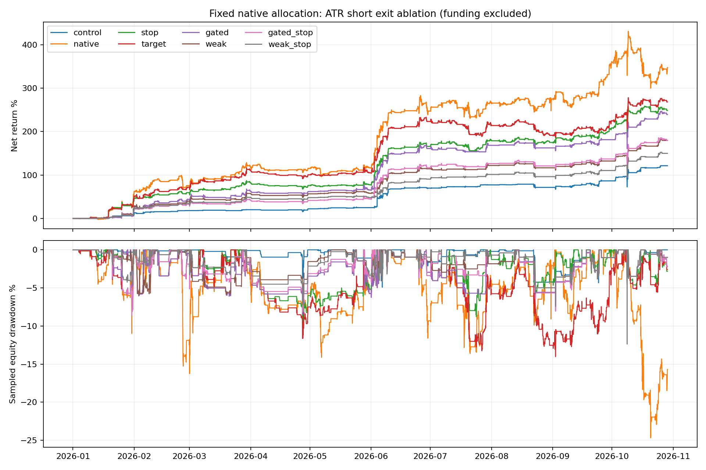

# 固定仓位：空头ATR退出、熊态门控与相对强弱

历史窗口为北京时间2026-01-01 08:00至2026-10-29 11:10；_july从北京时间7月1日08:00同本金重启。固定57币、10000 USDT初始钱包、3倍、6仓、首次成交24h退出；不增加原始NFI初始仓位，所有组禁止正向补仓。费用单边5bps，fee10为10bps真实重跑；资金费排除。4ULP同价舍入修正沿用既有协议。

用户诊断源码未提供，本轮为独立重建，不能称精确复现。control统一禁止补仓，因此不是旧版允许补仓的baseline_24h；不能把两者收益差直接归因于空头。原始多头信号和原生退出保留；long初始stake采用原版，无历史1.5/1.25加权。原始四空头与新增九空头按同样规则管理。熊态要求闭合BTC4h低于EMA200且EMA200较6根前下降；weak再要求个币闭合4h的24h收益低于BTC。只在入场过滤，不强制状态切换退出。

空头ATR14来自已收盘1h；固定初始距离max(2ATR,1%价格)，计划止损成本含双边费，初始保证金不超过原生额度且计划风险不超过当时可交易已实现钱包1%。非保证损失上限：跳空、滑点可突破预算。2R目标按5m回调当前价格触发，非盘中最高/最低价保证成交；止损由引擎执行。

|方案|交易|收益|含浮亏回撤|平仓回撤|组合PF|空头PF|7—10月区段收益|平均保证金/权益|
|---|---:|---:|---:|---:|---:|---:|---:|---:|
|base_risk|152|109.64%|13.32%|4.09%|4.26|0.88|22.99%|1.71%|
|budget|448|242.26%|15.03%|11.23%|1.79|1.36|24.52%|9.07%|
|control|152|121.41%|13.32%|4.09%|5.12|2.00|30.40%|1.81%|
|control_july|61|30.35%|13.31%|4.09%|3.85|4.01|30.35%|2.46%|
|gated|302|239.26%|13.32%|5.68%|2.57|1.87|30.01%|5.42%|
|gated_fee10|302|207.73%|13.55%|6.27%|2.41|1.74|27.76%|5.41%|
|gated_july|80|29.96%|13.32%|5.04%|2.27|1.29|29.96%|4.09%|
|gated_stop|319|179.37%|13.32%|5.04%|2.56|1.75|28.92%|4.32%|
|native|448|347.76%|25.77%|21.60%|1.67|1.34|28.92%|10.80%|
|stop|456|248.57%|12.78%|8.12%|1.98|1.49|31.08%|6.52%|
|target|438|268.37%|14.14%|12.85%|1.79|1.37|13.93%|8.66%|
|target_july|171|13.89%|13.07%|11.16%|1.22|0.82|13.89%|9.53%|
|weak|225|179.64%|13.32%|4.95%|2.98|2.00|30.51%|3.58%|
|weak_fee10|225|162.10%|13.55%|5.14%|2.82|1.87|29.04%|3.62%|
|weak_july|67|30.46%|13.32%|4.95%|2.73|1.55|30.46%|3.39%|
|weak_stop|236|149.86%|13.32%|4.95%|2.99|1.84|31.14%|2.98%|

## 关键对照判断

原生扩展347.76%→仅加ATR仓位上限242.26%→再启用真实ATR止损248.57%。native/budget的入场匹配见entry_matching；预算调整本身已改变保证金、复利和最终收益，不能把native到stop全部差额归因于止损。budget到stop的含浮亏回撤15.03%→12.78%，此处实际启用止损并未摧毁收益。
2R框架下空头自身PF：无门控1.37→熊态1.87→相对弱势2.00；弱势过滤提升质量但降低总收益，不能仅凭组合PF判定空头alpha大小。
门控/弱势的平仓回撤5.68%/4.95%，含浮亏回撤13.32%/13.32%。不得把前者称为组合真实最大风险。
7月同本金重启：control 30.35%、无门控2R 13.89%、门控2R 29.96%、相对弱势 30.46%。门控避免了多数无门控拖累，但两候选均没有显示相对原始核心明确的反弹收益优势；弱势相对control仅差0.11个百分点，不称稳健胜出。
双倍手续费全年：门控207.73%、弱势162.10%；这是真实重跑，仍未包括资金费或真实订单队列。
原始初始仓位没有放大，但新增短交易增加组合实际暴露，平均保证金/权益单列；这并非严格同组合风险匹配。个币ATR计划预算也不限制六仓同时开仓后的总计划损失。

control原生4空头；native增加9空头但仍原生退出；budget仅应用同样ATR推算仓位上限，不启用ATR止损；stop在budget上启用ATR止损并保留原生利润退出；target再替换空头利润退出为2R；gated再加熊态；weak再加相对弱势；base_risk是原生4空头采用同样ATR/2R预算；gated_stop/weak_stop保留原生利润退出而非2R，以复核退出和过滤的交互。

## 入口匹配与止损后恢复

entry_matching.json逐组按币种/入场时间/方向匹配，列出共同与新增/消失交易。预算、释放资金和复利会改变成交路径；收益百分点差不能当alpha贡献百分比。stop_recovery.json列出止损空单在首次入场24h内，后续闭合价格是否曾回到计费保本价；这是事后路径诊断，不代表该价格会被规则实际捕捉，也没有扣除持有期间风险和资金机会。

- stop：止损空单120，此后原持仓期限内曾回到保本价58。
- target：止损空单143，此后原持仓期限内曾回到保本价67。
- gated：止损空单82，此后原持仓期限内曾回到保本价39。
- weak：止损空单50，此后原持仓期限内曾回到保本价27。
- gated_stop：止损空单70，此后原持仓期限内曾回到保本价33。
- weak_stop：止损空单44，此后原持仓期限内曾回到保本价25。

## 最大回撤时持仓

drawdown_holdings.json记录各方案最大回撤时实际未平仓、方向、闭合标价和整轮当前损益。它解释风险集中，不把未平仓损益等同整个峰谷回撤。

- control：2026-10-09 01:50:00+08:00，多头6仓、空头0仓。
- gated：2026-10-09 01:50:00+08:00，多头6仓、空头0仓。
- weak：2026-10-09 01:50:00+08:00，多头6仓、空头0仓。
- gated_stop：2026-10-09 01:50:00+08:00，多头6仓、空头0仓。
- weak_stop：2026-10-09 01:50:00+08:00，多头6仓、空头0仓。

## 多空质量分开比较

|方案|方向|交易|PF|平均盈利保证金收益|平均亏损保证金收益|平均盈亏比|
|---|---|---:|---:|---:|---:|---:|
|base_risk|long|104|6.44|8.01%|-14.67%|0.55|
|base_risk|short|48|0.88|9.23%|-7.80%|1.18|
|budget|long|95|5.64|7.41%|-12.54%|0.59|
|budget|short|353|1.36|6.59%|-11.34%|0.58|
|control|long|104|6.40|8.01%|-14.67%|0.55|
|control|short|48|2.00|7.21%|-8.54%|0.84|
|control_july|long|45|3.82|7.61%|-11.90%|0.64|
|control_july|short|16|4.01|6.81%|-4.61%|1.48|
|gated|long|94|5.59|7.56%|-12.54%|0.60|
|gated|short|208|1.87|11.72%|-7.56%|1.55|
|gated_fee10|long|94|5.36|7.36%|-12.83%|0.57|
|gated_fee10|short|208|1.74|11.65%|-7.72%|1.51|
|gated_july|long|45|3.81|7.61%|-11.90%|0.64|
|gated_july|short|35|1.29|8.05%|-6.34%|1.27|
|gated_stop|long|95|5.55|7.41%|-12.54%|0.59|
|gated_stop|short|224|1.75|6.71%|-7.63%|0.88|
|native|long|95|5.56|7.41%|-12.54%|0.59|
|native|short|353|1.34|6.59%|-11.34%|0.58|
|stop|long|95|5.56|7.41%|-12.54%|0.59|
|stop|short|361|1.49|6.77%|-7.45%|0.91|
|target|long|94|5.67|7.56%|-12.54%|0.60|
|target|short|344|1.37|10.72%|-7.44%|1.44|
|target_july|long|45|3.81|7.61%|-11.90%|0.64|
|target_july|short|126|0.82|8.79%|-7.37%|1.19|
|weak|long|101|5.08|7.67%|-14.37%|0.53|
|weak|short|124|2.00|12.34%|-8.01%|1.54|
|weak_fee10|long|101|4.86|7.47%|-14.66%|0.51|
|weak_fee10|short|124|1.87|12.25%|-8.18%|1.50|
|weak_july|long|45|3.80|7.61%|-11.90%|0.64|
|weak_july|short|22|1.55|7.36%|-7.05%|1.04|
|weak_stop|long|101|5.09|7.67%|-14.37%|0.53|
|weak_stop|short|135|1.84|6.92%|-8.60%|0.80|

PF按实际USDT盈利/亏损加总，受仓位及复利影响；平均盈亏比按逐笔保证金收益率的盈利均值/亏损均值计算，二者并不相同。baseline含空头，不称纯多头。

## 证据边界

回撤主要用5m闭合价格重建全部持仓权益，另保留真实小时标记价回撤；非盘中最坏回撤。平仓余额回撤单列，不替代含浮亏回撤。所有历史已查看，含事后静态选币及研究选择偏差，不称独立样本外。禁止由更高历史收益推断未来胜率；不启动实盘。

复现：`.venv/bin/python nfi_atr_short.py control native budget stop target gated weak base_risk gated_stop weak_stop --workers 2`，随后`.venv/bin/python nfi_atr_report.py`。各成功目录拒绝覆盖；费用和7月独立本金测试使用--fee、--start、--suffix。

后续冻结与风险研究见[FORWARD.md](../../../research/nfi/atr_short/FORWARD.md)。

