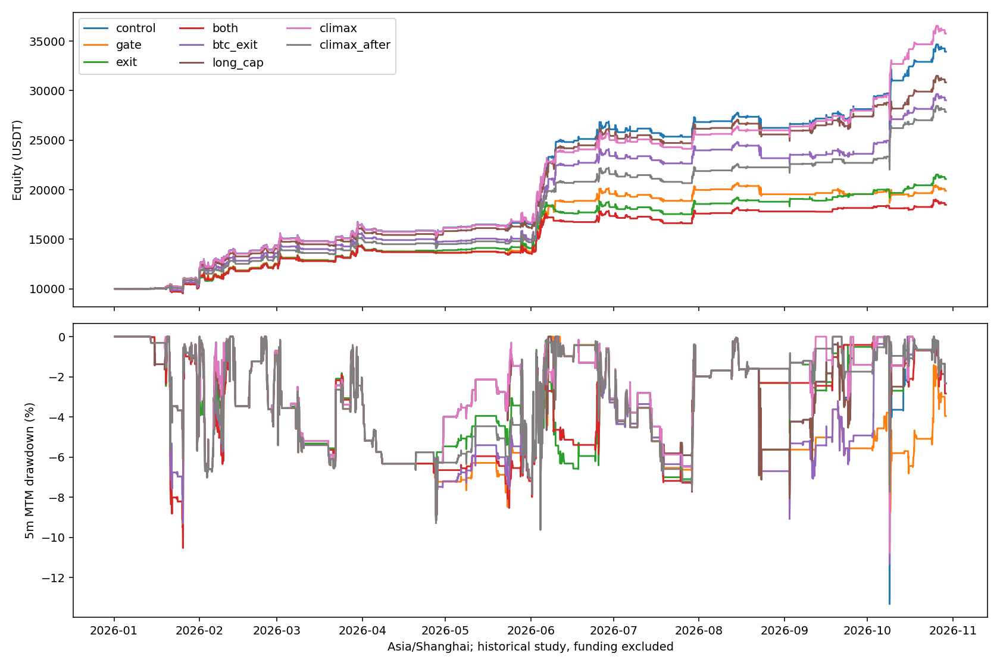

# NFI市场广度与共振风险研究

固定历史北京时间2026-01-01 08:00至10-29 11:10；57静态币、10000USDT、3倍/最多6仓、禁补仓、首次入场24h。单边手续费5bps；fee10为10bps真实重跑；july为7月1日同10000本金重启。资金费排除。全部历史已经查看，不是独立样本外；静态币池有事后及存活者偏差。

## 指标与实验

精确同步已闭合5m，不前填缺失报价。每币15m对数收益除以此前288根5m收益标准差乘sqrt(3)，标准差再后移3根，剔除当前15m冲击。至少20个有效币，且覆盖当时已成熟币的80%；成熟需从首次观察经过24h15m，缺失币不会从已成熟分母消失。

原始冲击：有效币15m下跌比例>=80%，且横截面标准化跌幅中位数<=-1.5。等权并非等风险，无成交量或市值事后筛选。market_features.csv.gz中的date是UTC开盘时间，5分钟后才可使用。

- control：原框架，逐笔与上一轮完全一致。
- gate：过去12根5m内有广度冲击则拒绝新多头；未知覆盖也拒绝新多头。
- exit：只有在首次入场之后新闭合的原始广度冲击，才请求退出已有多头；旧冲击不触发入场即退出，未知不强平。
- both：合并gate和exit。
- btc_exit：相同入场后时间限制，BTC15m对数收益<负1.5倍已闭合1hATR/BTC价格则退已有多头。BTC与广度归一化、频率不同，不能称严格同风险匹配。
- climax（事后追加）：纯修复组要求已知广度且过去1h有冲击，保留趋势/混合信号及空头原逻辑；climax_after额外要求当前不满足原始冲击。原阈值不变，基于已看过的原交易诊断启发，不是预先盲测。当前冲击标记消失可能来自波动率分母变化，不等于已经反转。
- *_reverse：原57币排序完整反转，control和climax成对重放；只改变新信号争用6个槽位的先后，不改变币池、指标或其他配置。不搜索哪个排序最好。
- long_cap：最多2个真实已开/待成交多头，空头仍可占全局6仓；不增加原单笔额度。此前side_cap则限制两个方向各最多2仓，须区分。

空头信号、ATR退出、风险预算和原始仓位上限不变；钱包和槽位会改变后续实际交易与金额。未扫描阈值。

|方案|交易|多头赢/亏|组合收益|持仓权益回撤|Ulcer|日ES95|冲击退出|平均保证金/权益|
|---|---:|---:|---:|---:|---:|---:|---:|---:|
|control|302|83/11|239.26%|13.32%|3.52%|-2.64%|0|5.42%|
|gate|247|29/9|98.88%|10.52%|4.65%|-2.70%|0|4.69%|
|exit|323|68/47|110.81%|9.61%|3.89%|-2.58%|78|4.44%|
|both|247|23/15|84.79%|10.52%|4.18%|-2.47%|22|4.26%|
|btc_exit|311|83/20|190.27%|11.32%|4.30%|-2.75%|22|5.15%|
|long_cap|292|73/11|208.27%|9.61%|3.51%|-2.56%|0|5.26%|
|climax|295|80/7|257.53%|10.77%|3.26%|-2.36%|0|5.05%|
|climax_after|264|49/7|178.51%|9.61%|3.64%|-2.31%|0|4.68%|
|both_fee10|247|22/16|68.86%|10.43%|4.37%|-2.51%|22|4.17%|
|both_july|58|16/7|5.30%|6.52%|2.62%|-1.36%|13|2.24%|
|climax_fee10|295|80/7|221.55%|10.79%|3.38%|-2.39%|0|5.01%|
|climax_july|74|36/3|42.91%|10.77%|2.11%|-1.65%|0|3.34%|
|climax_reverse|299|82/8|261.46%|11.35%|3.60%|-2.36%|0|5.05%|
|control_reverse|306|85/12|238.87%|13.32%|3.84%|-2.64%|0|5.41%|
|long_cap_fee10|291|72/11|178.57%|9.40%|3.59%|-2.58%|0|5.23%|
|long_cap_july|74|32/7|21.17%|8.04%|2.93%|-2.23%|0|3.71%|

适应性追加的依据：原63笔纯反弹组中，有近期广度冲击的51笔49赢2亏、净11252.22USDT；无近期冲击的12笔8赢4亏、净6.24USDT。该原路径统计带标签及资金配置偏差，不是重新分配钱包后的收益；见baseline_cohorts.json与climax_plan.json。

Ulcer为5m持仓权益回撤百分比均方根；日ES95为完整北京时间日收益最差5%均值。还保留回撤持续时长、最差滚动24h和p95名义敞口。5m收盘和整点标记价格不是盘中极值；冲击时真实滑点和订单队列未被精确模拟。

## 原始路径及最差事件诊断

评价期原始冲击2574根、1423段，门控15332根，未知覆盖0根。门控信号并不只出现在极少数崩盘事件。

原94笔多头中，门控在入场时会标记55笔原盈利和2笔原亏损；入场后、原退出前出现冲击的有52笔原盈利及11笔原亏损。这只是原路径标签审计，不是删除交易后的收益，不包含新路径的机会成本。

原最差回撤在北京时间10月9日01:50，持有6个多头。ALGO/JUP入场时未被门控，首次入场后冲击在10月8日23:05；另外4个在23:25入场时已有冲击。指标在该事件中早于谷值，但6笔原持仓5笔最终盈利，提前识别共同下跌不等于能预测是否会修复。逐笔时间及原路径利润见baseline_event_diagnosis.json。

## 简单规则与历史参照

|参照|组合收益|持仓权益回撤|
|---|---:|---:|
|baseline_fee10|207.73%|13.55%|
|baseline_july|29.96%|13.32%|
|prior_btc_gate|184.39%|9.61%|
|prior_side_cap|111.34%|8.04%|
|prior_half_long|152.50%|9.61%|

先按初始计划筛选收益及回撤同时不劣于control的指标规则，无则对both做负面对照。另行记录的风险取舍标准为保留75%基线收益、回撤至少减少20%、Ulcer及ES不恶化；至多另选一个收益/回撤最高者。附加资格在全部主实验完成前、long_cap完成前记录，属于已看过历史的研究者选择，不是样本外。

原规则实际检验选择：both, long_cap；收益资格：[]；风险取舍资格：['long_cap']。费用和重启都保留真实引擎资金路径，不简单减手续费；固定路径2/5/10bps滑点压力另存comparison.json，不替代真实冲击成交验证。

## 结论与复现

追加climax两组后按climax_plan.json单独检验资格，保留原门控/退出失败，不修改初始规则与阈值。该阶段完整选择记录见climax_validation_selection.json。

climax相对原框架少了12个原多头入场时点（8个原盈利、4个原亏损），新产生5笔多头且本段全部盈利，描述性净利润1814.47USDT，其中APT/ONDO集中在10月8日同一事件。钱包、后续交易和复利都会变化，不能把这些数字直接相加解释为因果alpha。改善集中于少数新增交易，见climax_cohort_audit.json。

当前没有自动晋级或核心替换。指标是否有价值，需同时看收益保留、浮亏回撤、尾部风险、持续性和暴露；不能只挑选是否避开已知一次崩盘。短周期共振也可能是原策略的反弹入场背景，广度风险标记不等于未来方向预测。

完整复现依次使用`.venv/bin/python`执行：`nfi_breadth.py control gate exit both btc_exit long_cap --workers 2` → `nfi_breadth_features.py` → `nfi_breadth_validate.py` → `nfi_breadth.py climax climax_after --workers 2` → `nfi_breadth_climax_validate.py` → `nfi_breadth.py control climax --reverse-pairs --suffix _reverse --workers 2` → `nfi_breadth_climax_audit.py` → `nfi_breadth_report.py` → `nfi_breadth_plot.py`。已完成目录拒绝覆盖。全部测试命令保留在execution_evidence.zip的tests.log。没有下单、启动服务或发布环境。

## 候选的风险与收益

climax收益257.53%对比原框架239.26%，持仓权益回撤10.77%对比13.32%；Ulcer 3.26%对比3.52%，日ES95 -2.36%对比-2.64%，平均保证金/权益5.05%对比5.42%。原始仓位上限、3倍杠杆、禁止补仓与24h期限保持。

平仓回撤则为5.95%，原框架5.68%，这项指标略有恶化，不能宣称所有风险维度都改善。保留climax为冻结后新增数据检验的研究候选；long_cap是另一个偏低峰值回撤的取舍。没有自动替换核心或授权实盘。

## 固定币种排序敏感性

|排序|原框架收益|climax收益|收益差|原框架回撤|climax回撤|
|---|---:|---:|---:|---:|---:|
|original|239.26%|257.53%|+18.27pp|13.32%|10.77%|
|reverse|238.87%|261.46%|+22.59pp|13.32%|11.35%|

本检验仍是已看过历史、单一币池和两种固定排序，不证明未来收益，也不能选择更好排序作为新基线。
