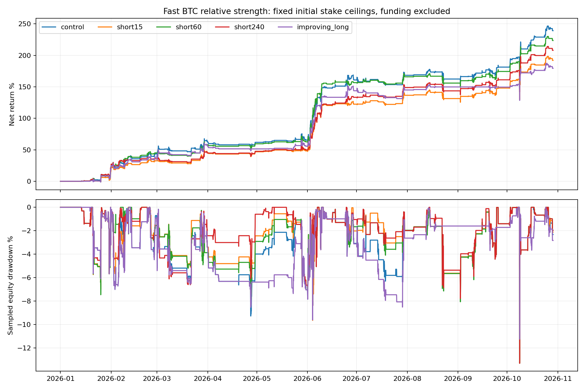

# 小周期BTC相对强弱：多空选择实验

固定历史窗口：北京时间2026-01-01 08:00至10月29日11:10。57静态币、10000 USDT、3倍、6仓、禁补仓、首次入场24h；原始初始stake上限，空头2x闭合1hATR14（价格距离至少1%）/2R与计费计划风险1%上限，多头原生退出。所有空头仍受闭合BTC4h熊态门控；相对强弱不替代大周期方向。单边5bps，fee10为10bps真实重跑，资金费排除。保留4ULP同价浮点边界协议。

RS_h=log(C_t/C_{t-h})-log(BTC_t/BTC_{t-h})，以同一已收盘5m时间戳计算15m/1h/4h窗口，每5m更新。遇到窗口缺口拒绝使用，不拿旧BTC价格前向补齐。Beta版本用测量1小时前已知的最近7天同步5m收益协方差/方差估计beta，再计算1h个币收益-beta*BTC收益；没有扣除回归截距，不将其称为已证明alpha。BTC自身统一豁免相对过滤。

原始NFI信号成立后才过滤：long要求正RS，short要求负RS；不凭指标独立开单、不加大仓位、不按已知交易盈亏删币。both15/both60/both240过滤两边；short15/short60/short240仅过滤空头，后两个补充时间窗是在识别多头混淆后追加的探索；long60只过滤多头；confirm要求1h和4h方向一致；beta60用Beta调整1h分数；momentum60还要求个币绝对1h收益方向与交易一致；improving_long是查看首批结果后追加的探索对照，仅要求多头最近15m的相对收益高于前一个不重叠15m窗口，空头保持原框架。

|全年方案|交易|组合收益|含浮亏回撤|多头PF|空头PF|连续钱包7—10月收益|平均保证金/权益|
|---|---:|---:|---:|---:|---:|---:|---:|
|beta60|159|95.37%|9.12%|—|2.38|4.92%|3.06%|
|both15|184|73.93%|11.77%|8.75|1.87|11.58%|3.55%|
|both240|165|75.21%|10.70%|3.62|2.09|9.26%|2.94%|
|both60|164|79.90%|10.64%|—|2.08|1.94%|3.19%|
|confirm|135|64.79%|9.41%|—|2.14|2.95%|2.53%|
|control|302|239.26%|13.32%|5.59|1.87|30.01%|5.42%|
|improving_long|254|179.44%|11.26%|9.51|1.88|14.62%|4.74%|
|long60|217|93.46%|10.52%|—|1.89|5.14%|4.17%|
|momentum60|154|73.61%|10.64%|—|2.12|3.51%|3.00%|
|short15|258|192.07%|13.32%|5.66|1.88|31.28%|4.63%|
|short240|241|208.00%|13.32%|5.43|2.07|31.98%|4.09%|
|short60|252|223.62%|13.32%|5.91|1.98|26.08%|4.45%|

## 预定的独立本金与费用压力

_july在北京时间7月1日08:00以10000 USDT重新启动；更早数据只供指标预热。fee10覆盖全年。三个预定候选是both60/short60/confirm；short240是在全区间结果显示近期改善后追加的适应性复核，记录于phase4.json。所有历史已看过，这不是独立样本外。下表参照沿用旧ATR门控组，前提是新control逐笔交易及损益与旧gated完全一致。

|方案|区间收益|含浮亏回撤|交易|
|---|---:|---:|---:|
|reference_gated_july|29.96%|13.32%|80|
|reference_gated_fee10|207.73%|13.55%|302|
|both60_fee10|69.15%|10.53%|164|
|both60_july|1.90%|5.20%|29|
|confirm_fee10|56.91%|9.31%|135|
|confirm_july|2.91%|4.26%|26|
|short240_fee10|186.17%|13.55%|241|
|short240_july|31.93%|13.32%|71|
|short60_fee10|198.68%|13.55%|252|
|short60_july|26.04%|13.32%|70|

## 本轮判断

1h同时过滤收益79.90%，只过滤多头93.46%，只过滤空头223.62%，对照239.26%。分方向证据显示，直接要求回调型多头短期正RS会删除主要盈利来源；只空短期弱币提高空头PF或降低暴露，不代表提高组合总收益。
追加相对改善多头收益179.44%，仍需相对control比较；该假设是在首批诊断后提出，不能称预先独立验证。
只过滤空头的三个时间窗：short15 192.07%, short60 223.62%, short240 208.00%；对照239.26%。
所有本轮完整区间过滤变体收益均未超过对照。本轮不替换当前入场逻辑，不将更高PF、更低暴露或更小回撤单独称为收益优化成功；观察工具与实盘策略采用分开。
4h只空弱币的追加复核：7月同本金收益31.93% vs参照29.96%，差1.97个百分点；全年双倍手续费收益186.17% vs参照207.73%。它体现近期表现和全年收益的取舍，非全周期胜出；在看到近期结果后选择复核，不是新的独立样本外。
原始同窗口RS跨币排序与USDT涨跌排序相同，因为每个币减去同一个BTC收益；Beta调整改变不同个币的市场敏感度比较，但没有自动产生可盈利信号。指标适合观察市场背景，是否过滤入场必须服从具体策略及真实回放证据。
7月同本金重启：both60_july 1.90%, short60_july 26.04%, confirm_july 2.91%；参照29.96%。

## 原始信号路径诊断

entry_diagnosis.json记录基线每次入场前最后闭合5m的分数、原始信号族与最终损益，分方向统计会被过滤的原始赢家和输家。它解释过滤器偏好；事后删掉这些交易并相加，不等同于真实过滤策略收益。实际效果以上述引擎重跑为准。

- 15分钟/long：原赢家被挡72笔，原输家被挡11笔；被挡原路径净损益11939.87 USDT。
- 15分钟/short：原赢家被挡28笔，原输家被挡33笔；被挡原路径净损益1951.23 USDT。
- 60分钟/long：原赢家被挡76笔，原输家被挡11笔；被挡原路径净损益12532.45 USDT。
- 60分钟/short：原赢家被挡34笔，原输家被挡39笔；被挡原路径净损益3225.73 USDT。
- 240分钟/long：原赢家被挡68笔，原输家被挡8笔；被挡原路径净损益11251.56 USDT。
- 240分钟/short：原赢家被挡39笔，原输家被挡44笔；被挡原路径净损益2186.04 USDT。

## 解释限制与复现

本轮是正负强弱作为入场过滤的对照，尚未测试在同一时点已成立的NFI候选之间重新排序、分配有限持仓槽位；不能从过滤失败推断排序没有帮助。冻结观察表只提供描述性排序，不会更改策略优先级。全部沿用已经查看的历史和事后静态币池，有存活者及研究选择偏差。短周期强弱可能只是高beta、噪声或短期超涨超跌，不能据更新更快推断预测更好。NFI回调/均值回归多头可能在短期RS为负时入场，强行只买短期强币会删除这类有效信号；分方向重跑用于检验而非预设结论。

收益表为组合；PF按方向实际USDT盈利/亏损计算，受复利与资金路径影响。初始单笔上限不变，但筛选会改变交易次数、槽位占用、平均暴露和后续多头机会；不是严格同组合风险匹配。权益回撤按闭合5m价格采样，另保留真实小时标价回撤，不含盘中极值。1%计划风险不能保证跳空或限价未成交后的真实损失；没有启动实盘。

复现：`.venv/bin/python nfi_fast_rs.py control both60 short60 long60 both15 both240 confirm beta60 momentum60 --workers 2`；费用压力对both60/short60/confirm加`--fee .001 --suffix _fee10`，同本金近期对照加`--start 2026-07-01T00:00:00Z --suffix _july`。报告`.venv/bin/python nfi_fast_rs_report.py`。成功目录拒绝覆盖。

观察表见[冻结历史强弱表](latest_snapshot.md)，指标解释见[INDICATOR.md](../../../research/nfi/fast_rs/INDICATOR.md)，后续约束见[FORWARD.md](../../../research/nfi/fast_rs/FORWARD.md)。

