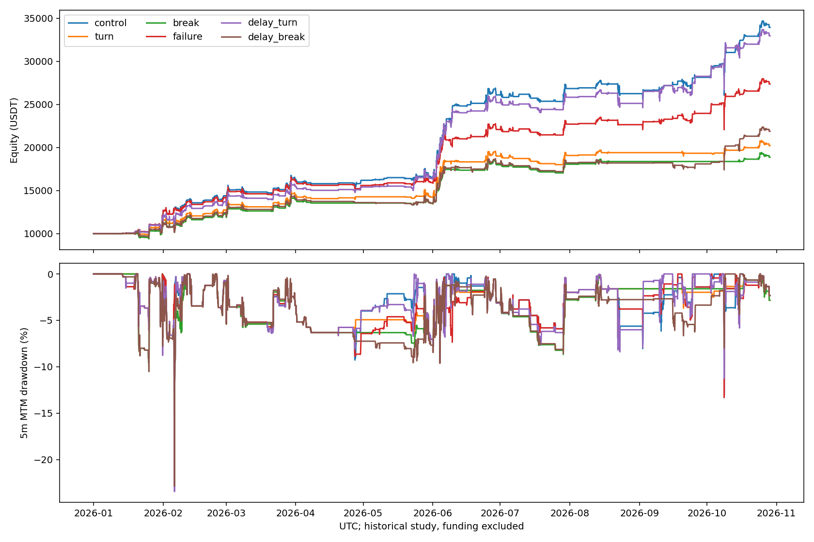

# NFI多头入场及交易失效研究

固定57币、10000USDT、3倍/6仓、禁补仓、首次入场24小时。北京时间2026-01-01 08:00至10-29 11:10；未更新行情。手续费单边5bps，fee10为10bps真实引擎重跑；资金费排除。全部历史已经查看，不是独立样本外。

空头信号、ATR退出及仓位计算代码未变；多头变化仍会影响共享钱包、持仓槽位与随后空头成交，不能要求空头交易路径保持一致。control逐笔与前轮基线完全相同。

## 原路径诊断

94笔多头83赢11亏。11亏损全部24h退出，9笔曾有闭合5m净浮盈；但其中若干浮盈很小，不能推断均能无损保本。盈利单有15笔在6h仍持仓且浮亏、9笔在12h仍浮亏。对应亏损单分别9与10笔，因此按持仓时长直接切亏会误杀盈利单。逐笔含实际减仓、费用的现金流路径见diagnosis.json；不是删除交易后的策略收益。

## 冻结规则

- turn：原入场信号同时要求最近闭合5m收盘上涨、低点不低于前一根。
- break：原信号同时要求闭合5m收盘突破此前3根5m最高价。两组均是信号当下确认，不是持有旧信号等待未来触发。
- failure：原入场不变；首次成交冻结当时最近12根闭合5m低点和已闭合1h ATR14；满6小时且剩余持仓价格低于入场价、跌破该低点减0.5ATR时退出。不是固定亏损6小时即卖出。原盈利退出及24h优先。
- delay_turn/delay_break：原信号及原标签最多保留30分钟和6根K线，在确认出现后入场；遇到空头信号不覆盖空头。该延迟窗口在第一轮指标完成前追加，仍属已查看历史的探索。
- failure状态本轮只存离线回测实例内存，没有实现服务重启恢复，不作为实盘可用实现。

|方案|交易|多头胜/负|组合收益|含浮亏回撤|多头失效退出|平均保证金/权益|
|---|---:|---:|---:|---:|---:|---:|
|control|302|83/11|239.26%|13.32%|0|5.42%|
|turn|223|13/2|102.07%|9.61%|0|4.32%|
|break|213|4/0|88.62%|10.52%|0|4.12%|
|delay_turn|303|78/18|229.57%|23.46%|0|5.94%|
|delay_break|257|35/13|118.79%|22.87%|0|5.11%|
|failure|302|76/18|173.67%|13.32%|19|5.04%|
|failure_fee10|302|76/18|148.22%|14.03%|19|5.03%|
|failure_july|80|35/10|23.90%|13.32%|10|3.49%|

结构失效组匹配原入场后：11笔原亏损6笔按净收益率减亏、5笔反而亏得更多；8笔原盈利提前退出，其中7笔转亏。剩余仓价格低于入场价不等于整轮净亏损，SUI部分减仓后的整轮仍盈利。完整逐笔比较见matched_failure_exits.json，不以不同复利钱包的绝对利润差作为因果贡献。

不能仅按胜率或少数坏单是否消失选型。必须同时看被提前退出的潜在盈利单、净收益保留、持仓浮亏及共享钱包机会成本。7月同本金重启仍是已查看历史，只检查资金路径敏感性。5m权益回撤不是盘中极值，限价回测不代表真实盘口成交。

复现：`.venv/bin/python nfi_long_entry.py control turn break failure --workers 2`；完成目录拒绝覆盖。完整复现还需运行延迟组`delay_turn delay_break`及failure的`--fee .001 --suffix _fee10`和`--start 2026-07-01T00:00:00Z --suffix _july`。之后运行`nfi_long_diagnose.py`、`nfi_long_failure_audit.py`、`nfi_long_entry_report.py`与`nfi_long_entry_plot.py`。没有启动实盘或发布环境。

## 结论

本轮未找到可替换原核心的多头改进，不晋级任何新规则。即时确认严重损伤收益；30分钟延迟确认的最大回撤均超过22%；6h结构失效退出损伤收益且未降低最大权益回撤。双费及7月同本金检验亦未支持失效退出。

延迟组最差回撤发生在北京时间2月6日08:20，均持有4个多头；原核心和失效退出组则在10月9日01:50持有6个多头。改变入场可能引入原策略没有承受的新风险，不能只检查旧亏损单是否消失。实际持仓见drawdown_holdings.json；持仓浮盈亏不是整个峰谷回撤的因果归因。

## 回撤持续性与尾部风险

|方案|Ulcer指数|日ES95|最差滚动24h|
|---|---:|---:|---:|
|control|3.52%|-2.64%|-13.32%|
|turn|3.76%|-2.26%|-6.55%|
|break|4.08%|-2.41%|-8.01%|
|delay_turn|3.60%|-2.77%|-18.06%|
|delay_break|4.46%|-2.73%|-17.13%|
|failure|3.72%|-2.63%|-13.32%|
|failure_fee10|3.84%|-2.67%|-13.47%|
|failure_july|2.49%|-2.16%|-13.32%|

日ES95为已完成北京时间日收益最差5%均值；Ulcer为5m权益回撤百分比均方根。两者定义沿用portfolio_risk。

## 同口径旧基线参照

|基线|组合收益|持仓权益回撤|
|---|---:|---:|
|gated_fee10|207.73%|13.55%|
|gated_july|29.96%|13.32%|

