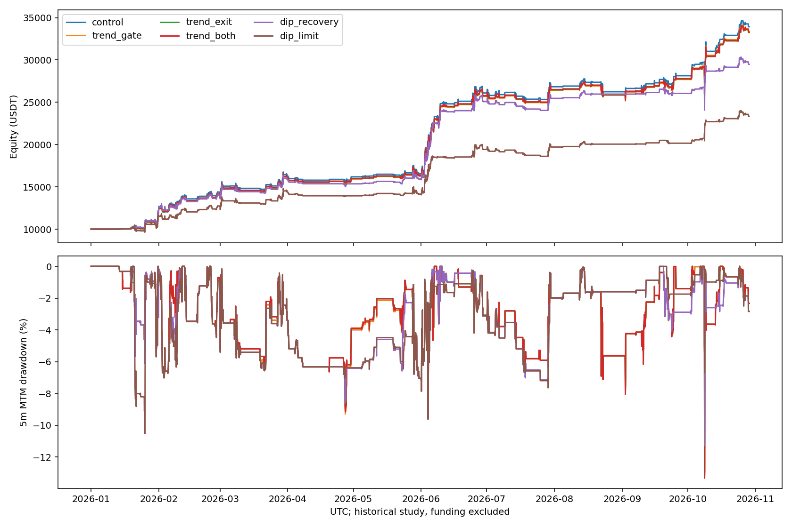

# NFI按多头信号原理分组研究

北京时间2026-01-01 08:00至2026-10-29 11:10，固定57币、10000USDT、3倍/最多6仓、禁补仓、首次入场24小时。手续费单边5bps；fee10为10bps真实重跑，july为7月1日同本金重启。全部历史已经查看、静态币池存在事后偏差；不是独立样本外，资金费排除。

## 分组依据

按固定上游原始触发条件分组：21为强均线背景下回调；47为短均线金叉转强；64为上涨中的超卖回调；65为布林上轨突破；161为均线金叉且高于1h/4h EMA200。其余27个启用标签主要是急跌、均线负乖离、超卖及修复。此为研究分类，不是官方策略命名；源码最后触发条件之外仍有大量原生保护条件。混合或未知标签保持原逻辑。

|基线信号组|交易|赢/亏|净利润USDT|PF|
|---|---:|---:|---:|---:|
|trend|30|25/5|1672.71|3.08048640648463|
|dip|63|57/6|11258.47|6.442223291403096|
|mixed_or_unknown|1|1/0|254.62|—|

原生仓位模式不同，且共享复利钱包；上表不是各组独立配置同本金后的收益，也不是因果alpha分解。完整触发条件、行号及逐笔归属见source_and_baseline_diagnosis.json。

## 冻结实验

- control：原信号、仓位和退出不变，逐笔对齐前轮基线。
- trend_gate：仅顺势/转强/突破组要求最新已闭合1h收盘高于EMA50，EMA50高于6小时前。
- trend_exit：仅该组，持有至少2h后连续两根已闭合1h收盘低于各自EMA50则退出；原生盈利退出和24h上限保留。trend_both合并两项，作为机制消融。
- dip_recovery：仅纯急跌修复组，最近15m对BTC相对对数收益高于前一个不重叠15m窗口；BTC自身豁免。不是要求已强于BTC，空头不受过滤。
- dip_limit：仅纯急跌修复组，委托买价在原拟入场价下方0.5倍已闭合1hATR，距离最多1.9%。保持原仓位上限、原3分钟未成交超时；回测以5m处理订单，不模拟真实盘口队列。未成交后错过反弹属于结果，不能仅比较成交价格更低的交易。
- 限价组有额外执行限制：原3分钟超时短于5m主周期，现有K线无法确认触价发生在超时前。5m引擎按整根K线触价成交，可能乐观；即使收益改善，也需更细成交数据验证，不能据此晋级。
- 全部组空头信号、ATR退出及风险预算原样保留；共享钱包和持仓槽位仍可能使实际空头交易与配置金额变化。

|方案|交易|多头赢/亏|组合收益|含浮亏回撤|Ulcer|日ES95|平均保证金/权益|
|---|---:|---:|---:|---:|---:|---:|---:|
|control|302|83/11|239.26%|13.32%|3.52%|-2.64%|5.42%|
|trend_gate|300|81/11|233.97%|13.32%|3.52%|-2.64%|5.40%|
|trend_exit|302|81/13|232.50%|13.32%|3.50%|-2.63%|5.37%|
|trend_both|300|80/12|232.97%|13.32%|3.50%|-2.63%|5.37%|
|dip_recovery|270|55/7|194.86%|11.26%|3.70%|-2.31%|4.85%|
|dip_limit|258|44/5|133.44%|10.52%|3.80%|-2.41%|4.40%|
|trend_both_fee10|300|80/12|202.22%|14.10%|3.59%|-2.66%|5.36%|
|trend_both_july|80|37/8|29.15%|13.31%|2.98%|-2.42%|4.05%|

Ulcer为5m权益回撤百分比均方根；日ES95为完整北京时间日收益最差5%均值。回撤包含持仓浮亏，是离散闭合5m采样，不是盘中极值。最大回撤时实际持仓见drawdown_holdings.json；不能将该时点持仓浮亏直接解释为整个峰谷回撤贡献。

## 费用、同本金及旧规则参照

|原框架参照|收益|持仓权益回撤|
|---|---:|---:|
|gated_fee10|207.73%|13.55%|
|gated_july|29.96%|13.32%|
|prior_global_recovery|179.44%|11.26%|
|prior_half_long|152.50%|9.61%|

各组comparison.json还保留2/5/10bps固定成交路径滑点压力，它不是新订单路径重跑；费用重跑与固定路径扣费分开解释。

## 研究结论

分组后的相对恢复组194.86%、回撤11.26%，比旧全多头统一相对恢复过滤179.44%、11.26%保留更多收益；但原框架239.26%、13.32%仍有更高收益。它改善了旧过滤方案，尚未证明改善核心。限价组133.44%、10.52%还不如此前简单多头减半152.50%、9.61%的收益与回撤，且有额外成交假设限制。

原时点匹配审计：趋势确认没有消除原趋势组5笔亏损，缺失的2个原入场时点均属原盈利；反弹相对恢复过滤未重复42个原盈利时点和4个原亏损时点，并产生14个新多头时点；低价限价未重复51个原盈利和6个原亏损时点，并产生12个新多头时点。时点缺失可来自过滤、未成交、持仓与槽位变化，不等于直接因果；见entry_cohort_audit.json。原坏单全部消失也不保证改进。

趋势退出组6笔触发退出，匹配原始入场后3笔原亏损减亏、1笔原亏损扩大，2笔原盈利转亏；趋势确认加退出组5笔触发退出，3笔减亏、1笔原亏损扩大、1笔原盈利转亏。见matched_exit_diagnosis.json。减少某几笔亏损不代表组合净增益。

全年收益和最大回撤同时达到基线的规则：无。这一筛选不代表通过稳健性验证，必须结合尾部损失、费用、近期同本金和暴露变化判断。核心保持原样，不晋级实盘。

初始实现因Pandas3原生时间戳精度不同，在指标合并时失败，未进入交易模拟；原始代码及执行记录保存在implementation_failure。统一UTC纳秒精度后重跑，金融规则未变，新增真实时间戳单位测试。未扫描阈值，保留全部金融变体。

复现：`.venv/bin/python nfi_long_family.py control trend_gate trend_exit trend_both dip_recovery dip_limit --workers 2`；完成目录拒绝覆盖。然后运行`nfi_long_family_diagnose.py`、`nfi_long_family_report.py`与`nfi_long_family_plot.py`。

