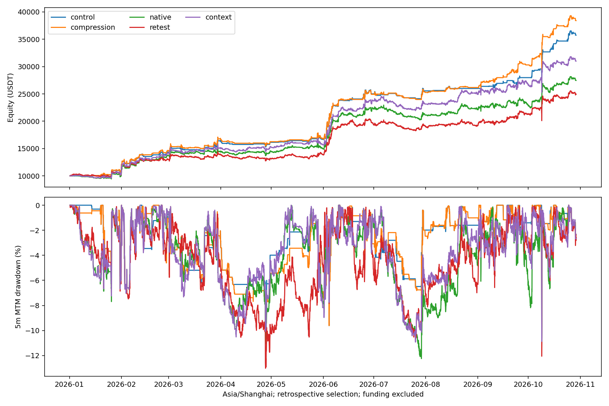

# 增加有意义的多头机会：真实引擎实验

研究窗口2026-01-01 08:00至2026-10-29 11:10（北京时间）。57个固定OKX USDT永续、初始10,000 USDT、3倍杠杆、总计最多6仓、首次入场起24小时、禁止补仓。手续费单边5bps；资金费按用户要求排除。含浮亏回撤按5m收盘权益计算，不是盘中极值。

本轮对照为上一轮breadth/climax研究候选（257.53%），不是官方57币原版，也不是更早239.26%的ATR空头基线。原配置与核心均未替换，没有实盘或环境发布。

## 结论

有价值的新增机会来自波动压缩后的突破，而非普遍增加交易次数。原生166（挤压释放）与169（闭合1h内包线突破）组合，使总收益257.53%→284.18%，含浮亏回撤10.77%→10.65%。这是历史探索候选，尚非稳健性的前向证据。

新增88笔独立多头，43赢/45亏，扣手续费净赚1697.38 USDT，PF 1.52，中位持仓18.50小时。多头总数87→174，有多头入场的北京时间日数55→109；新增交易分布在67天。

## 全部方案

|方案|总交易|新增交易|新增净利润USDT|新增PF|组合收益|含浮亏回撤|Ulcer|日ES95|平均保证金/权益|
|---|---:|---:|---:|---:|---:|---:|---:|---:|---:|
|control|295|0|0.00|—|257.53%|10.77%|3.26%|-2.36%|5.05%|
|pullback|449|161|-667.72|0.92|233.88%|11.10%|3.50%|-2.42%|6.07%|
|breakout|1058|771|-1983.37|0.94|200.66%|12.31%|4.46%|-2.51%|9.47%|
|native|1060|776|-3080.44|0.90|174.68%|12.24%|4.71%|-2.55%|9.54%|
|retest|1129|858|-3788.16|0.87|149.27%|13.01%|5.08%|-2.64%|10.64%|
|combined|1208|939|-3413.57|0.90|164.00%|17.53%|7.59%|-2.66%|10.83%|
|compression|381|88|1697.38|1.52|284.18%|10.65%|3.42%|-2.35%|5.74%|
|context|1053|765|-1423.11|0.96|210.09%|10.93%|4.32%|-2.47%|9.21%|

pullback：48/165/167；breakout：7/8/166/169/171；native：前两组并集；retest：独立突破回踩、闭合1h/4h向上且1h相对BTC走强；combined：并集；context：8种原生信号增加同样趋势/相对强弱/广度门槛；compression：166/169。默认关闭的原生信号不等于官方推荐。

初始五个扩展全部新增净亏。突破组中周高突破8产生711笔，净亏约2,243 USDT；单独166/169子组表现较好，才追加compression与context。因此compression是明确的事后筛选，不能称所有选择均事先注册。未扫描数值阈值，仍存在多重尝试与选择偏差。完整初始计划、适应性修订和失败结果均保留。

## 新仓的纪律

只在当根没有原多/空信号时添加；新增最多2仓，但可能挤占未来原信号。每仓含费用计划损失不超过当时已实现可交易钱包0.5%，保证金不超过普通额度1/4；固定2倍已闭合1h ATR且至少价格1%的止损距离、价格2R目标。禁止补仓及部分减仓，24h从首次入场计。止盈按5m回调报价，不按K线高点假定成交；止损由真实引擎执行，跳空可超过预算。2R不是实际净盈亏比承诺。

原仓交易逻辑保留；所有实成交新增仓的独立ATR/手续费/仓位预算复核见comparison.json的risk_audit。风险预算不是最大回撤或实际损失保证。

## 同预算与压力对照

fixed将所有多空普通入场额度额外限制到当前已实现可交易钱包/6；不是给历史赢家加权，也不读取未来基线。该上限在本次5bps、全年配置下没有改变实际订单：control_fixed与control、compression_fixed与compression逐笔一致。可排除此上限所检查的额度扩张，不能据此排除复利、暴露和机会挤占。

|条件|对照收益|compression收益|对照回撤|compression回撤|
|---|---:|---:|---:|---:|
|固定预算全年|257.53%|284.18%|10.77%|10.65%|
|单边10bps|221.55%|241.83%|10.79%|10.78%|
|7月同10,000本金重启|42.91%|52.35%|10.77%|10.65%|
|反转57币优先顺序|261.46%|283.07%|11.35%|11.44%|

压力测试实际重跑订单与钱包，不是事后减手续费或删交易；7月重启仍是已查看历史。逆序只是固定敏感性对照，不选择收益更高的排序。资格结果见selection.json；必须连同adaptive_plan.json阅读，后续信号子组选择为事后。

## 赚的是什么钱，付出什么代价

166要求先有持续波动挤压再向上释放，169要求已闭合1h内包结构向上突破，二者仍带原生趋势约束。新仓用固定ATR退出，收益不依赖扩宽止损、补仓或持仓跨越周期。胜率约49%，赚钱依靠盈利幅度与受控损失的组合；并非每次突破都有效。

新增仓平均盈利115.39、平均亏损72.55 USDT，实际金额盈亏比约1.59（含不同大小仓位，非标准化R）。23笔目标退出、32笔止损、33笔24h到期。8—9月新增净利润合计2516.62 USDT，超过全年新增净利，10月为−459.27 USDT；效果具有明显行情依赖。组合Ulcer由3.26%上升至3.42%，不能只凭最大回撤略降宣称所有风险改善。

平均保证金/权益5.05%→5.74%，实际暴露增加；已平仓账面回撤5.95%→6.22%。新增信号提供了正净利润，但不能把更高暴露、复利和历史选择带来的全部组合差额称为免费alpha。

组合较对照净多2665.17 USDT，其中新增仓实际净利润1697.38，旧仓实际利润差967.79。后者混合钱包复利、仓位、交易挤占等路径变化，不是可单独归因的额外alpha。未复现的原入场时点3个，不能把原赢家利润简单加回。

新增仓最赚钱5笔合计1537.54 USDT（全部新增净利润1697.38）；币种、月份和退出原因见compression_cohorts.json。利润集中度与24h到期退出必须持续观察，不按事后赢家筛币。

## 局限与下一步

全部2026历史都已查看，57币是静态今日推荐池，存在幸存者和币池选择偏差；5m OHLCV回测不包含实际盘口排队、冲击和用户排除的资金费。止损可能跳空。源自原生的条件不代表对每个指标做过完整因果证明；新自编特征有前缀不变性/闭合时序单位测试。没有独立样本外结果。

建议冻结166/169规则、原池排序与风险预算，再记录尚未发生的前向信号、可成交价格、手续费/资金费与被挤占原信号；不要继续在同一历史上挑币、挑月或提高赢家仓位。当前仅保存离线候选，没有自动晋级核心。

复现：`.venv/bin/python nfi_opportunities.py control pullback breakout native retest combined compression context --workers 2`；再运行`.venv/bin/python nfi_op_validate.py`、`nfi_op_report.py`、`nfi_op_plot.py`，封存后运行`nfi_op_verify.py`。成功回测拒绝覆盖。执行计划及全部金融源码见research/nfi/opportunities；初始内存故障源码/日志另存implementation_failure与execution_evidence.zip。

