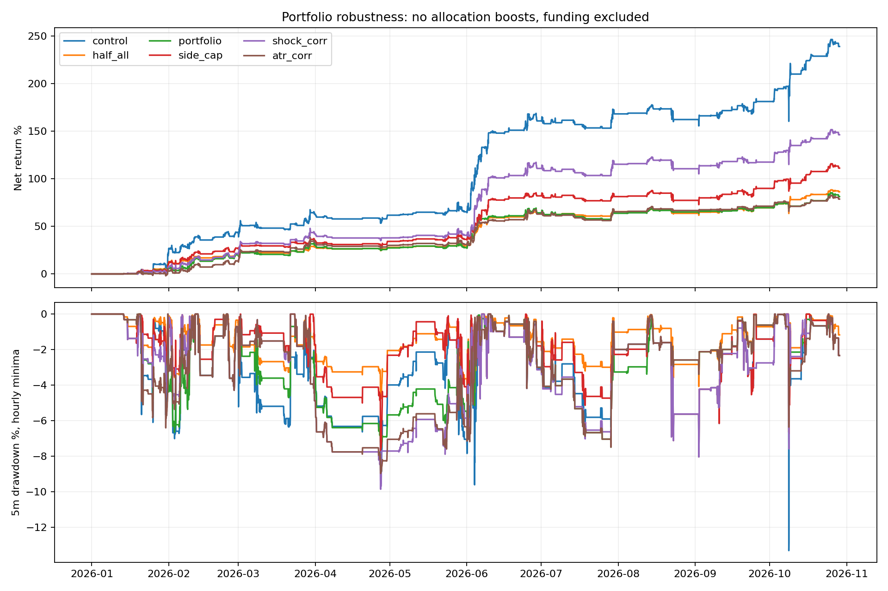

# NFI组合风险与稳健性

固定历史：北京时间2026-01-01 08:00至2026-10-29 11:10；57静态币、10000 USDT、3倍、最多6仓、禁补仓、首次入场24h。基础是NFIShortATRGated：原生多头退出，扩展空头2x1hATR/2R与1%预算及BTC4h熊态门控。无仓位放大乘数。单边5bps，fee10为10bps真实重跑，资金费排除，沿用4ULP同价浮点修正。

风险指标：个币闭合1h ATR14；BTC过去15m跌幅相对闭合1hATR的冲击；BTC1h实现波动相对前7天中位值（参考剔除当前1h）；过去7天闭合1h收益相关性。阈值固定，不扫描优化。当前数据均已查看；不是独立样本外。

|年初至今方案|交易|净收益|含浮亏回撤|收益/回撤|Ulcer指数|日ES95|最差滚动24h|平均保证金/权益|
|---|---:|---:|---:|---:|---:|---:|---:|---:|
|atr_corr|274|78.76%|8.97%|8.78|3.89%|-2.09%|-5.70%|3.84%|
|control|302|239.26%|13.32%|17.97|3.52%|-2.64%|-13.32%|5.42%|
|cooldown|284|78.63%|7.63%|10.31|3.50%|-2.14%|-5.38%|3.80%|
|correlation|268|189.45%|13.32%|14.23|3.63%|-2.45%|-13.32%|4.71%|
|half_all|302|86.45%|6.66%|12.99|1.80%|-1.32%|-6.66%|2.73%|
|half_long|302|152.50%|9.61%|15.87|3.64%|-2.34%|-6.66%|4.76%|
|long_atr|304|114.05%|9.61%|11.87|3.70%|-2.43%|-6.55%|4.57%|
|long_budget|302|148.58%|9.61%|15.46|3.62%|-2.31%|-6.55%|4.73%|
|long_stop|304|158.34%|12.49%|12.67|3.84%|-2.96%|-11.87%|5.14%|
|portfolio|286|81.43%|7.63%|10.68|3.47%|-2.13%|-5.38%|3.80%|
|shock|286|184.39%|9.61%|19.18|3.85%|-2.43%|-7.59%|5.01%|
|shock_corr|253|146.43%|9.86%|14.85|4.04%|-2.23%|-7.59%|4.31%|
|side_cap|219|111.34%|8.04%|13.85|2.53%|-2.10%|-6.75%|3.87%|
|volatility|302|177.35%|9.96%|17.81|3.69%|-2.53%|-9.96%|5.08%|

收益/回撤是本段累计收益除以样本回撤，不年化，不是预测未来Calmar。Ulcer为5m权益回撤百分比的均方根；日ES95为已完成北京时间日收益最差5%均值（不含首个缺少前日收盘比较日与末个未完成日），越负表示尾部损失越重。5m权益及真实小时标价不是盘中极值。水下时长是组合权益恢复跨度，不是单笔持仓；最大水下时长和占比保留在comparison.json，末期未修复段按已观察时长记并标注右删失。

## 机制对照

- half_all：多空两边初始保证金同时减半，其他不变，用作组合限风险的公平缩仓对照。half_long：所有多头初始保证金减半，空头不变。long_budget：按假设2ATR止损限制多头计划风险1%，仍用原生退出，不实际启用该止损，只作仓位对照。long_stop：实际2ATR多头止损，原始初始额度，不额外1%限仓。long_atr：同时启用多头1%限仓和2ATR止损，保留原生盈利退出。距离至少价格1%，冻结首次成交价对应水平。

- portfolio：long_atr之上，入场前将全部未平仓剩余数量的计划止损损失（含双边费）相加，最多当时可交易已实现钱包3%；不将多空风险相抵。真实未成交Trade保留风险额度，未知风险拒绝新增；减仓释放相应剩余数量额度。已有仓不因钱包下降被强制重设预算，因此这是入场限制，不是持续保证。

- cooldown：portfolio基础上，同币多头止损后1h内拒绝新多头；过去滚动1h若任意币累计至少2笔多头止损，则在该条件仍成立时拒绝新多头。只用当时已平仓记录，未来平仓不参与。

- shock：BTC15m对数收益低于负1.5倍闭合1hATR/价格后，过去1h内存在该冲击就拒绝新多头，不强平已有仓。volatility：BTC1h跌且1h实现波动超过剔除当前小时的前7日中位数2倍时，新多头保证金减半；其余不增加额度。

- shock_corr结合现有shock与correlation；atr_corr结合现有long_atr与correlation。它们来自已知风险事件的互补性诊断，是事后探索，保持原有参数。

- correlation：新仓若与已有至少2个同向仓的7日小时收益相关性>=0.75，则拒绝；至少120共同观测，不足按1保守处理。这是新仓邻域规则，不是保证传递聚类。side_cap是不看相关性的同向最多2仓对照，名义全局上限仍6。相关序列在指标阶段缓存完整向量，决策时严格切到已闭合小时，避免第一次信号缓存成永久旧历史。

## 同本金重启与费用压力

初始计划half_long/long_atr/portfolio/correlation；首批结果显示long_atr在相近回撤下不如简单减仓，于phase2.json记录将该组资格复核改为half_all，保留long_atr完整年初至今诊断。half_long/half_all/portfolio分别做7月同10000本金重启与年初至今10bps；correlation保留已排定的年初至今10bps负面对照，不额外7月资格复核。phase3.json记录追加side_cap与shock的年初至今10bps及7月同本金复核；phase4.json追加已有规则shock_corr/atr_corr组合及同样复核，没有扫描新阈值。较早历史仅作预热，全部仍是已看过历史。原门控参照沿用既有结果，前提是新control逐笔完全一致。

|方案|区间收益|含浮亏回撤|Ulcer|日ES95|
|---|---:|---:|---:|---:|
|reference_gated_july|29.96%|13.32%|—|—|
|reference_gated_fee10|207.73%|13.55%|—|—|
|atr_corr_fee10|66.41%|9.07%|4.00%|-2.14%|
|atr_corr_july|9.64%|6.42%|2.60%|-1.43%|
|correlation_fee10|167.65%|13.55%|3.72%|-2.47%|
|half_all_fee10|77.41%|6.79%|1.83%|-1.34%|
|half_all_july|14.23%|6.66%|1.50%|-1.21%|
|half_long_fee10|131.27%|9.40%|3.73%|-2.37%|
|half_long_july|16.26%|6.66%|2.67%|-1.66%|
|portfolio_fee10|69.54%|7.70%|3.64%|-2.17%|
|portfolio_july|10.37%|6.42%|2.55%|-1.39%|
|shock_corr_fee10|128.80%|9.99%|4.15%|-2.26%|
|shock_corr_july|16.75%|8.04%|3.15%|-2.14%|
|shock_fee10|159.12%|9.40%|3.94%|-2.47%|
|shock_july|18.34%|8.04%|3.15%|-2.14%|
|side_cap_fee10|97.27%|8.27%|2.59%|-2.11%|
|side_cap_july|15.97%|8.04%|2.95%|-2.23%|

## 本轮判断

简单双向减半：收益86.45%，回撤6.66%，日ES95 -1.32%，Ulcer 1.80%；原框架分别239.26%、13.32%、-2.64%、3.52%。主要是承担更少风险，不能称信号alpha提高。
3%计划预算框架收益81.43%、回撤7.63%，在本样本收益/回撤上不如双向减半。预算实现被订单审计验证，但机械风险约束正确不等于收益与稳健性优化成功。普通相关性组收益189.45%、回撤13.32%，未改善原框架最大回撤。
组合shock_corr：收益146.43%，回撤9.86%，Ulcer 4.04%；不能因单个风险指标改善就宣称整体更稳。组合是在查看风险事件后追加，参数未改变，仍有适应性选择偏差。
组合atr_corr：收益78.76%，回撤8.97%，Ulcer 3.89%；不能因单个风险指标改善就宣称整体更稳。组合是在查看风险事件后追加，参数未改变，仍有适应性选择偏差。
最大回撤时实际持仓、入场前相关矩阵见drawdown_diagnosis.json；这些持仓是事后选择用来解释风险，不是按结果拟合的新交易规则。后续限制见[FORWARD.md](../../../research/nfi/portfolio_risk/FORWARD.md)。

## 组合计划风险审计

risk_budget_audit.json将实际订单数量、首次成交前已闭合1hATR与手续费独立重建，并核对入场日志。已确认本版引擎Order.close_bt_order在入场回调前重算数量；日志应包含新仓。对同时间戳退出用保守剩余暴露下界，并单独核对新仓风险，避免事件排序伪造精度。未知未成交预留可使日志大于已成交下界。

- cooldown：核对284笔入场，最高合计计划风险3.0000%，最高单笔0.9828%。
- portfolio：核对286笔入场，最高合计计划风险3.0000%，最高单笔0.9828%。
- portfolio_fee10：核对283笔入场，最高合计计划风险3.0000%，最高单笔0.9824%。
- portfolio_july：核对81笔入场，最高合计计划风险2.9999%，最高单笔0.9708%。

1%与3%都是计划损失，不是实际亏损、最大回撤或任何市场状态下的保证上限。跳空、连续多次止损、手续费与流动性变化可使真实损失超预算；所有实验保留真实引擎订单与费用，不事后删超期或亏损交易。

## 解释边界与复现

本轮不使用更多指标数量代表有效性。简单减仓或少开仓本来就会降低部分风险，必须对照收益保留、尾部损失和平均暴露，不能把全部回撤降低称作预测能力。当前币池事后选择、已看过历史、样本最大回撤与限价成交模拟都有局限。没有启动实盘或其他交易服务。

复现：`.venv/bin/python nfi_portfolio.py control half_all half_long long_budget long_stop long_atr portfolio cooldown shock volatility correlation side_cap --workers 2`；再运行`.venv/bin/python nfi_portfolio_report.py`。费用压力加`--fee .001 --suffix _fee10`，7月重启加`--start 2026-07-01T00:00:00Z --suffix _july`。成功目录拒绝覆盖。

