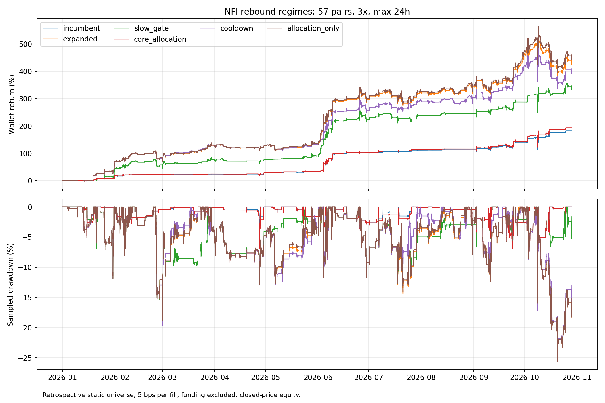
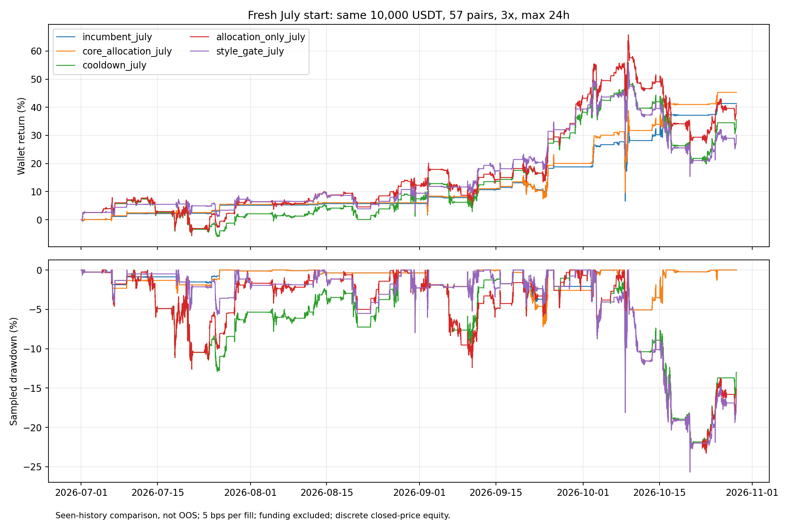

# NFI反弹状态优化

研究窗口2026-01-01 00:00 UTC至2026-10-29 03:10 UTC，57固定币、同一10,000 USDT初始钱包、3倍杠杆、6仓、首次入场起24小时上限，禁止补仓。单边手续费5bps，资金费排除。沿用已披露的4ULP机器舍入成交边界修正，所有参照同口径。

目标是改善反弹区间收益，交易规则只读已闭合BTC/个币状态，不以7月等日历日期切换。7—10月用于事后描述和候选选择，已被反复查看，不是新样本外。

|方案|年初至今收益|连续钱包7—10月收益|含浮亏回撤|7—10月空头净利润USDT|平均保证金/权益|
|---|---:|---:|---:|---:|---:|
|incumbent|184.32%|41.37%|16.56%|861.72|1.88%|
|expanded|444.89%|37.39%|25.64%|-1390.63|10.70%|
|slow_gate|349.59%|39.09%|18.86%|522.13|6.75%|
|fast|259.26%|20.54%|25.64%|-5136.95|6.64%|
|soft|319.16%|25.58%|25.64%|-4355.92|7.91%|
|long_bias|273.01%|23.93%|25.64%|-5407.91|6.76%|
|local|312.01%|19.18%|18.26%|-5469.25|8.27%|
|cover_loss|362.45%|22.57%|25.64%|-5559.07|7.85%|
|cooldown|409.99%|42.50%|25.50%|201.97|9.36%|
|allocation_only|463.91%|40.80%|25.64%|-1646.09|10.81%|
|style_gate|333.73%|30.11%|25.64%|-3382.77|7.39%|
|core_allocation|195.14%|45.33%|16.56%|871.15|1.99%|

空头净利润按入场所属区段归因；连续区间收益按日历权益切割，跨月仓位的归属会有差异。

## 机制

- incumbent：此前加权且禁止补仓核心。expanded：额外启用9个原生空头。slow_gate：新增9个空头只在闭合BTC4h低于EMA200且均线24小时下行时启用。
- fast：闭合BTC4h价格高于EMA50且EMA12>EMA50为反弹/上涨，禁开所有空头；两条件均反向为偏空，允许全部13个空头；混合状态只保留原生4个。既有仓位不因状态变化强制退出。
- soft：信号保留，偏空/混合/上涨状态将初始空头仓位分别乘1/0.5/0.25。减少仓位不会释放占用的持仓槽位。
- long_bias：fast基础上，上涨状态多头初始仓位额外乘1.25并受钱包上限限制。它增加资金暴露，不能把全部增益视为信号质量提高。
- local：不用BTC禁止全部空头，改为只允许个币闭合4h EMA12<EMA50且RSI14<50时做空，测试反弹中只空弱币。

- cover_loss：保留原生扩展入场；空单持有至少1小时、闭合BTC状态转强且整轮净损益为负时退出，原有退出及24h期限保留。
- cooldown：只对额外9个空头模式按已平仓记录准入；同主标签最近5笔净收益率合计为负，距最新平仓不足72h时暂停新入场。到期后允许重新尝试，既有持仓及原生4个空头不因此改变。仅使用当前时刻已平仓记录；此机制在看到首批开关失效后追加，存在适应性研究偏差。

- allocation_only：拆分long_bias的两个机制，保留全部扩展信号，仅在上涨状态将多头初始仓位乘1.25。该对照用于判断资金配置增益，不把增加暴露当成新的信号alpha。

- style_gate：非偏空状态保留原生4个空头与543超买衰竭、545失败突破、546布林上轨拒绝；其余新增趋势/回落延续模式仅在偏空状态允许。分类依据固定源码语义，仍保留此前亏损的545，没有按本段盈亏删标签。

- core_allocation：同一1.25上涨期多头资金因子直接应用旧核心（仅原生4个空头），用于分离扩展空头拖累和资金使用效果；没有扫描因子，不称为同风险alpha。

## 月度含浮亏收益

|月份|incumbent|expanded|slow_gate|fast|soft|long_bias|local|cover_loss|cooldown|allocation_only|style_gate|core_allocation|
|---|---:|---:|---:|---:|---:|---:|---:|---:|---:|---:|---:|---:|
|2026-01|18.07%|69.68%|45.12%|46.12%|53.16%|46.34%|62.41%|68.32%|69.68%|69.93%|50.01%|18.24%|
|2026-02|4.24%|7.40%|7.40%|5.09%|5.67%|5.15%|7.17%|4.95%|6.36%|7.45%|6.35%|4.29%|
|2026-03|0.64%|24.01%|12.43%|5.91%|12.55%|5.97%|13.70%|13.52%|25.37%|24.08%|11.99%|0.70%|
|2026-04|3.48%|0.55%|1.34%|0.63%|1.04%|0.69%|-0.34%|2.05%|0.55%|0.61%|1.40%|3.54%|
|2026-05|3.05%|2.45%|6.83%|6.89%|6.44%|7.44%|3.61%|8.21%|2.01%|2.98%|8.01%|3.59%|
|2026-06|52.27%|70.37%|70.37%|70.37%|70.37%|70.61%|69.17%|70.37%|54.23%|70.61%|70.37%|52.48%|
|2026-07|5.15%|6.00%|4.59%|6.26%|6.10%|6.57%|-0.95%|1.83%|9.18%|6.31%|6.37%|5.47%|
|2026-08|0.56%|5.60%|2.14%|2.26%|3.06%|2.26%|-0.20%|2.04%|3.38%|5.60%|2.88%|0.56%|
|2026-09|12.34%|26.63%|12.34%|14.82%|18.34%|15.71%|14.98%|19.59%|28.64%|27.55%|27.36%|13.19%|
|2026-10|19.01%|-3.07%|15.89%|-3.39%|-2.95%|-1.72%|4.86%|-1.36%|-1.85%|-1.66%|-6.65%|21.07%|

## 独立初始化与成本压力

_july从7月1日以10,000 USDT重新启动真实引擎，之前数据仅作指标预热；这检验复利/资金路径影响，仍不是未查看历史。_fee10将手续费提高到单边10bps重新运行订单与资金路径，不是简单扣费。

|重跑|窗口收益|含浮亏回撤|交易数|
|---|---:|---:|---:|
|allocation_only_july|40.74%|25.67%|169|
|cooldown_july|35.60%|25.53%|153|
|core_allocation_july|45.28%|16.56%|58|
|core_allocation_july_fee10|45.43%|17.31%|58|
|incumbent_july|41.33%|16.56%|58|
|incumbent_july_fee10|41.10%|17.18%|58|
|style_gate_july|30.05%|25.67%|117|
|style_gate_july_fee10|26.24%|26.17%|117|

## 本轮判断

更快或更强的禁空并不自动改善反弹收益：fast/soft/local及存量亏损空头提前退出都未稳健超过旧核心。冷却的连续钱包近期收益42.50%看似略高，但7月重启仅35.60%，低于旧核心41.33%；依赖前半年资金与已平仓状态，不能据此选为通用反弹增强。

更干净的增益来自旧核心资金配置：7月同本金收益41.33%→45.28%，5m回撤16.56%→16.56%。平均保证金/权益2.50%→2.70%。这保留原生4空头，信号不扩充；上涨状态多头初始仓位乘1.25，杠杆仍3倍，实际资金暴露增加。

双倍手续费同口径近期收益41.10%→45.43%。该改善在这一历史成本压力下保留，但仍未模拟真实盘口队列、滑点及用户排除的资金费。原生退出依赖扣费后损益，改费率会改变退出时间和后续资金路径；本段双费结果略高不代表提高成本普遍有益。

候选是资金分配改善，不是证明新增指标或空头预测更准确；样本最大回撤相近不代表未来风险不变。继续冻结规则做前向模拟，配置保持停止，历史选择结果不直接作为实盘授权。

## 解释边界与复现

完整结果及信号族、方向、币种、成本、到期退出、订单现金流对账见comparison.json和各归档。5m权益回撤是离散闭合价格采样，不是盘中极值；整点真实标记价格回撤也保留。当前静态币池、已查看历史与自适应候选选择存在事后偏差。没有启动实盘或前向模拟。

运行`.venv/bin/python nfi_rebound.py fast soft long_bias local cover_loss cooldown allocation_only style_gate core_allocation --workers 2`，再运行`.venv/bin/python nfi_rebound_report.py`。近期同钱包对照使用`--start 2026-07-01T00:00:00Z --suffix _july`，双倍费用使用`--fee .001 --suffix _fee10`。成功目录拒绝覆盖。

