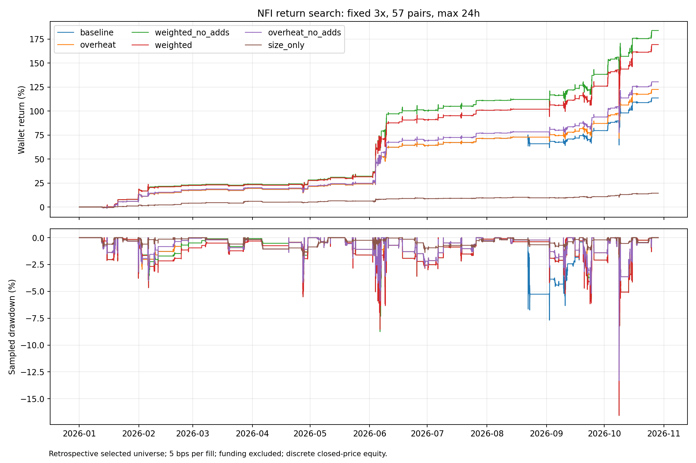

# NFI X8：以收益率为目标的机制实验

用户授权扩大指标、信号和持仓管理研究。首批预先固定8项机制，第二批在前四项结果出现后增加2项组合/延长盈利持仓假设，第三批组合资金加权和禁止补仓，没有扫描参数网格；全部是适应性回顾研究，保留所有结果。原版源码未改，继承类与分批计划位于research/nfi/return_search。

统一窗口：2026-01-01至2026-10-29北京时间11:10。57币、10,000 USDT同一初始钱包、3倍杠杆、最多6仓；首次入场后24h必须平仓，补仓不重置计时。单边5bps手续费已计入，资金费未计入。所有历史均已被查看，静态选币存在事后及存活者偏差，不是独立样本外。

|方案|交易数|收益|含浮亏回撤|胜率|利润因子|最差月|额外10bps成交成本后收益|
|---|---:|---:|---:|---:|---:|---:|---:|
|weighted_no_adds|149|184.01%|16.56%|81.21%|8.34|0.56%|164.93%|
|weighted|149|169.33%|16.56%|81.21%|8.00|0.56%|150.60%|
|overheat_no_adds|150|130.51%|13.32%|81.33%|6.78|0.87%|116.80%|
|trend_runner|150|127.31%|13.32%|80.67%|6.68|0.87%|113.46%|
|overheat|150|122.56%|13.32%|81.33%|6.56|0.87%|108.87%|
|no_adds|152|121.07%|13.32%|80.26%|5.11|-3.26%|107.24%|
|baseline|152|113.67%|13.32%|80.26%|4.99|-3.16%|99.83%|
|overheat_long|102|110.62%|13.32%|90.20%|9.35|-0.50%|99.25%|
|no_short_rebuy|106|110.02%|13.32%|88.68%|6.53|-3.75%|97.99%|
|long_only|104|102.22%|13.32%|88.46%|6.23|-3.75%|90.67%|
|campaign_trail|152|79.78%|12.92%|85.53%|6.06|0.72%|67.03%|
|relative_strength|104|71.88%|14.10%|78.85%|5.57|0.54%|64.58%|
|size_only|152|14.39%|1.83%|80.26%|2.85|-0.68%|12.03%|

额外成交成本是原订单路径不变的附加扣费，不是盘口重放。权益回撤按5m最后已收盘价格采样，非盘中极值；整点真实标记价格回撤也单独保留在JSON中。

## 机制与风险暴露

- long_only：基线上删除所有空头；no_short_rebuy：只删除含short-rebuy标签的入场；no_adds：禁止增加仓位，保留部分减仓。
- overheat_long：已知RSI80/20过滤叠加纯多头；relative_strength：增加已闭合4h的过去24h相对BTC收益指标，多头要求不弱于BTC，空头要求不强于BTC，BTC自身豁免。
- weighted：RSI过滤上，将long normal/top-coins初始保证金乘1.5、short-rebuy乘0.5。总钱包与杠杆不变，但实际资金暴露可能增加；收益差不能全部当成信号优势。
- campaign_trail：RSI过滤上，整轮净浮盈达到首笔保证金3%后，收盘净浮盈回落到历史峰值60%则退出；保留原有退出，首先执行24h期限。
- size_only：仅使用上一轮ATR初始缩仓，保留原版补仓和退出、取消ATR止损。它检验上一轮改善是否主要来自少下注，不承诺实际风险受冻结预算约束。

- 第二批overheat_no_adds组合过热过滤和禁止补仓；trend_runner在净盈利且闭合5m价格/EMA20斜率与闭合4h EMA12/EMA50趋势一致时延迟原生exit_profit退出，延迟后趋势破坏即退出，其余退出和24h约束保留。

- 第三批weighted_no_adds仅将现有资金加权与禁止补仓组合，保持所有权重和阈值不变，并进行正常/双倍手续费两次实际回放。

## 分段与集中度

|方案|1—6月收益|7—10月收益|最大5笔盈利占总盈利|最高持仓名义额USDT|平均保证金USDT|
|---|---:|---:|---:|---:|---:|
|weighted_no_adds|100.62%|41.57%|22.45%|76946.15|354.19|
|weighted|91.00%|41.02%|22.55%|72969.00|343.57|
|overheat_no_adds|69.38%|36.09%|17.57%|61514.99|272.56|
|trend_runner|68.21%|35.13%|17.51%|60658.54|273.07|
|overheat|64.18%|35.56%|17.72%|59393.41|268.91|
|no_adds|69.38%|30.51%|17.46%|58997.21|286.41|
|baseline|64.18%|30.15%|17.58%|57020.83|282.41|
|overheat_long|61.72%|30.24%|19.96%|56308.09|196.62|
|no_short_rebuy|61.72%|29.86%|18.92%|56147.05|215.69|
|long_only|61.72%|25.04%|19.81%|54063.70|210.16|
|campaign_trail|50.06%|19.80%|20.48%|49504.10|142.20|
|relative_strength|40.11%|22.67%|24.12%|48291.95|151.91|
|size_only|8.72%|5.21%|13.41%|5937.77|64.21|

## 结果判断

本轮最高历史收益是weighted_no_adds，收益184.01%、含浮亏回撤16.56%；基线为113.67%和13.32%。它保持3倍杠杆与同一钱包，但资金加权改变实际保证金和名义持仓，不能将全部增益称为信号优势。

相对更少改变资金分配的候选为overheat_no_adds，收益130.51%。它组合禁止补仓和已知过热过滤，仍有同一区间组合选择偏差。纯多头、相对BTC强弱过滤、提前追踪止盈都未提高收益；高胜率本身不是本轮优化目标。

纯初始缩仓size_only为14.39%收益、1.83%回撤；上一轮带ATR止损和补仓预算的budget为12.43%、1.83%。因此回撤下降主要来自初始缩仓；止损与补仓约束的组合未显示额外优势。这个对照还不能分别分离止损与补仓限制的贡献。

建议将weighted_no_adds作为收益优先的研究候选，overheat_no_adds作为不提高初始仓位的对照。保持前向配置停止，不将历史最高收益直接等同于可实盘。下一步检验应冻结规则记录未来信号，而不是继续在本段历史上微调到更高数字。

## 双倍手续费真实重跑

以下每笔成交单边10bps手续费，重新运行完整引擎、订单和资金路径；不是从原利润中简单扣费。该压力检查仍未模拟真实盘口滑点。

|方案|收益|5m权益回撤|交易数|
|---|---:|---:|---:|
|weighted_fee10|161.53%|17.18%|149|
|baseline_fee10|107.46%|13.55%|152|
|weighted_no_adds_fee10|175.92%|17.18%|149|

分段是同一连续资金路径的描述，7月起没有重置钱包；不是新的验证集。逐币、方向、信号族、补仓、时限退出和最差交易详见comparison.json。对照交易匹配见matching字段；交易减少后剩余仓位和未来信号会改变，不能只删掉旧交易再加减利润。

## 可复现

`.venv/bin/python nfi_optimize.py long_only no_short_rebuy no_adds overheat_long relative_strength weighted campaign_trail size_only overheat_no_adds trend_runner weighted_no_adds --workers 2`。已有结果目录拒绝覆盖；应另存后再重跑。成本压力用`--fee .001 --suffix _fee10`。完成后执行`.venv/bin/python nfi_optimize_report.py`。

两组并行回放使用独立钱包与用户缓存，原始交易ZIP与execution.json保存引擎证据。新增相对强弱指标只在4h完全收盘后可用，已测试尚未收盘的未来大幅变动不会影响当前结果。没有实盘进程或订单。

