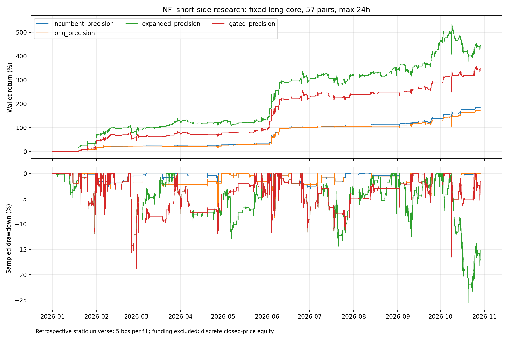

# NFI空头专项：镜像多头与熊市空头

固定57币、2026-01-01至2026-10-29北京时间11:10、10,000 USDT同一钱包、3倍杠杆、最多6仓。单边5bps手续费已计入，资金费排除；滑点另做固定路径敏感性。首次成交起24小时退出，不允许补仓重置。

incumbent是此前最佳weighted_no_adds；long_control删除其原生空头。自定义新信号组保持相同多头核心，替换为空头新信号；expanded_native则扩充原生空头开关。新空头与多头同bar冲突时优先多头，但仍会争用后续资金/持仓槽位，不能把空头净利润简单加到旧组合上。

|方案|总交易|总收益|5m浮动权益回撤|多头净利润USDT|空头笔数|空头净利润USDT|相对纯多头增量USDT|超24h笔数|
|---|---:|---:|---:|---:|---:|---:|---:|---:|
|incumbent|149|184.01%|16.56%|17477.47|48|923.78|1261.30|0|
|long_control|101|171.40%|16.56%|17139.95|0|0.00|0.00|0|
|pullback|1949|102.04%|46.79%|13667.74|1863|-3463.26|-6935.47|23|
|breakdown|2112|67.16%|43.71%|8525.71|2055|-1810.16|-10424.40|33|
|mirror|221|96.36%|17.34%|12452.08|129|-2816.00|-7503.87|1|
|pullback_slots|798|157.54%|19.43%|16888.40|698|-1133.90|-1385.45|5|
|breakdown_slots|869|172.30%|14.47%|17485.77|772|-255.44|90.38|14|
|mirror_slots|211|99.42%|16.96%|12748.14|119|-2805.70|-7197.51|0|
|expanded_native|445|447.45%|25.54%|28613.25|353|16131.33|27604.63|4|
|breakdown_rr1|1143|129.47%|21.16%|15946.00|1044|-2998.91|-4192.85|9|
|incumbent_precision|149|184.32%|16.56%|17506.63|48|925.69|1262.48|0|
|long_precision|101|171.70%|16.56%|17169.83|0|0.00|0.00|0|
|expanded_precision|445|444.89%|25.64%|28573.51|353|15915.09|27318.77|0|
|gated_precision|320|349.59%|18.86%|22294.60|228|12664.43|17789.20|0|

存在任何超24h或到期后加仓的版本均不合格。表中这些版本仅作失败诊断，不能作为符合用户期限要求的收益候选；没有删除超时交易美化收益。原分析函数默认仍严格拒绝超时，本报告显式保留失败数据以便审计。

后缀_precision统一修复了引擎将十进制同价因1个浮点最小单位误判为不成交的问题，仅在4ULP内认作同一边界价格，远小于一个市场报价档位。没有修改成交价或扩大到一个报价档位；入场和退出都使用相同规则。incumbent_precision与long_precision同口径重跑，最终比较只用这些同口径数据。具体反例、测试和协议见precision_evidence.json及research/nfi/short_search/precision_protocol.json。

## 测试的是什么

固定源码默认启用32条多头、4条空头条件；不是一套完全对称的规则。具体开关和源码哈希见research/nfi/short_search/asymmetry.json。启用数量不代表实际触发数量或有效性。

- pullback：闭合4h EMA12<EMA200、RSI25—50且日线ROC9为负；过去30分钟反弹触及闭合1h EMA20且5m RSI峰值≥60，随后5m收盘跌破自身EMA20。
- breakdown：相同熊市背景，5m收盘跌破此前12根低点，成交量超过20根均量1.2倍；RSI5m>25且距1h EMA20向下不超过5%，避免极端追跌。
- mirror：将原始OHLC按1/P变换（high与low交换），包括BTC与所有高周期，重新计算NFI指标和启用的多头入场，取normal/top-coins信号变为空头。保留实测成交量作活动权重，所有实际成交/损益都使用原始价格。倒数市场不是实际逆向合约；这是入场镜像实验，不是声称整个多头仓位管理已被严格镜像。

- 后缀_slots：相同信号、初始仓位和退出，但新空头最多同时2仓。该假设在看到原生多头因槽位不足被取消、尚未得到首批PnL时增加；仍属于回顾式适应性研究。

- expanded_native：额外启用已有实现的505/506、543/544/545/546/548、561/563空头条件，保留原生空头退出、资金加权、禁止补仓和24h期限。该组不使用新ATR管理，原生兜底仍极宽。它检验默认关闭的既有空头是否提供有效增量。

- breakdown_rr1：在两空头仓位版breakdown中仅将目标从2R改为1R，检验较近的退出能否改善24h持仓内兑现；其余规则不变。期限订单使用只读引擎追踪，撮合逻辑不改。

- expanded_precision是原生扩展在修正撮合浮点边界后的重跑；incumbent_precision、long_precision是同口径参照。单独的breakdown+BTC状态变体未执行，仅保留代码；后述gated则是实际执行的原生空头扩展开关。

- gated_precision：保留原生4个空头始终可用，额外9个空头只在闭合BTC4h低于EMA200且EMA200过去6根4h下降时准入。只控制新入场，不因状态变化强制平仓；长仓及其他规则不变。该末轮假设在看到上半年增益、7—10月负空头贡献后提出，存在明确事后选择偏差。

三类新空头采用统一退出：冻结2倍已闭合1h ATR14、至少1%价格距离的止损；2倍价格风险距离止盈，按当前开盘价检查止盈（不利用未来盘中低点）；从首次入场计时24h退出。禁止补仓。初始保证金至多普通槽位一半，并按1%可交易已结算权益计划风险取较小值，真实跳空可超预算。原生多头管理不增加新止损。

因此新空头结果同时取决于入场与统一退出，不能把优劣全部归因于入场信号；若继续研究，应分离退出机制贡献。所有结果都是已查看历史上的探索，币池含事后选择/存活者偏差，不是独立样本外验证。

## 空头质量与机会成本

|方案|空头胜率|平均盈利USDT|平均亏损USDT|空头利润因子|失去的纯多头入场数|
|---|---:|---:|---:|---:|---:|
|incumbent|62.50%|46.78|-26.65|2.93|0|
|long_control|0.00%|0.00|0.00|—|0|
|pullback|41.33%|101.59|-74.73|0.96|27|
|breakdown|42.87%|89.71|-68.86|0.98|46|
|mirror|32.56%|202.14|-129.95|0.75|10|
|pullback_slots|42.12%|104.41|-78.79|0.96|2|
|breakdown_slots|42.62%|116.75|-87.28|0.99|5|
|mirror_slots|31.93%|210.28|-133.29|0.74|10|
|expanded_native|73.37%|271.56|-576.62|1.30|9|
|breakdown_rr1|48.18%|79.86|-79.80|0.93|2|
|incumbent_precision|62.50%|46.86|-26.68|2.93|0|
|long_precision|0.00%|0.00|0.00|—|0|
|expanded_precision|73.37%|270.27|-575.38|1.29|9|
|gated_precision|75.44%|181.13|-330.18|1.68|9|

逐币、月份、止损/止盈/限时退出、长期利润变化、手续费/滑点敏感性见comparison.json。总收益差包含直接空头损益、复利、资金分配与错失多头机会。5m回撤是离散采样；整点真实标记价格敏感性另列，不能视为盘中最差风险界限。

## 原生扩展的同口径复核

- incumbent_precision：收益184.32%，含浮亏回撤16.56%，空头净利润925.69 USDT。
- long_precision：收益171.70%，含浮亏回撤16.56%，空头净利润0.00 USDT。
- expanded_precision：收益444.89%，含浮亏回撤25.64%，空头净利润15915.09 USDT。
- gated_precision：收益349.59%，含浮亏回撤18.86%，空头净利润12664.43 USDT。

|同口径方案|1—6月收益|7—10月收益|平均保证金/权益|平均名义敞口/权益|
|---|---:|---:|---:|---:|
|incumbent_precision|101.11%|41.37%|1.88%|0.056x|
|long_precision|99.76%|36.01%|1.65%|0.049x|
|expanded_precision|296.59%|37.39%|10.70%|0.323x|
|gated_precision|223.23%|39.09%|6.75%|0.203x|

这是连续复利资金路径的描述性分段，7月不重置钱包，不是新的留出验证。新增normal/quick空头沿用原生普通仓位，而562原生rebuy初始乘数为0.25、既有加权再乘0.5；单笔资金暴露并不等额。更高收益不能全部解释为同风险下的信号优势。

单边手续费从5bps提高到10bps后真实重跑：

- expanded_precision_fee10：收益377.43%，5m权益回撤26.14%。
- gated_precision_fee10：收益310.45%，5m权益回撤18.92%。

仍未计资金费，实际滑点并未被这项手续费压力完全模拟。

新增空头未来数据抽检5笔，使用独立完整/截断回放缓存：入场偏差0、退出偏差0、指标偏差0。抽样覆盖543/544/505/506，五币子集；不是所有信号和所有交易的穷尽证明，也不构成独立样本外。

## 判断与限制

简单熊市反弹/破位、倒数镜像入场均未提供稳定组合增量；最明显增益来自扩充原生空头覆盖。543是超买冲高后的衰竭，544是动量转弱/延续，505是ADX趋势启动，506是7日Donchian破位。它们捕捉的不是同一个“看到下跌就空”的机会。

原生扩展只改默认开关，仍含部分明显亏损信号，没有按本段盈亏事后删除545/548等亏损族。更高总收益既含直接空头利润，也含收益再投入对后续多头的放大，不应把组合增量全部归于独立空头alpha。

尤其要区分时期：未加BTC开关的扩展版空头在1—6月约+17,306 USDT、7—10月约-1,391 USDT；同一连续钱包7—10月收益37.39%，低于既有核心41.37%。数据中BTC从年初约87,593跌至6月底58,604，之后反弹到约81,310。不能把整个7—10月视为单边熊市，也不能用全年高收益证明近期同样更强。

状态开关版全年收益349.59%、回撤18.86%，7—10月收益39.09%，仍低于旧核心的41.37%。它将后四个月新组合空头贡献转正，但机会成本仍抵消了部分优势。当前阶段不能宣称近期组合收益已经大幅提升。

扩展版仍使用极宽原生止损兜底，限时退出约束的是持仓时间，不能保证亏损金额。历史排序、静态币池及固定上游规则均包含事后研究偏差。适合继续冻结后的前向模拟研究，不是实盘盈利承诺。

## 复现

`.venv/bin/python nfi_short_search.py long_control pullback breakdown mirror pullback_slots breakdown_slots mirror_slots expanded_native breakdown_rr1 --workers 2`，随后`.venv/bin/python nfi_short_report.py`。已有成功归档拒绝覆盖。每次回放使用独立userdir和同一统一钱包，不向交易所发送订单。

修正口径另运行`.venv/bin/python nfi_short_search.py incumbent_precision long_precision expanded_precision gated_precision --workers 2`；两扩展版成本重跑加`--fee .001 --suffix _fee10`。全部完成后再生成报告。未来数据抽检命令完整保存在causality_execution.json中。

首次pullback/breakdown未完成轮次因高密度交易的状态读取性能瓶颈中断，日志与执行记录保存在attempts。随后为冻结止损/目标增加只读缓存再回放，规则和阈值不变；未把未完成轮次当作交易结果。

