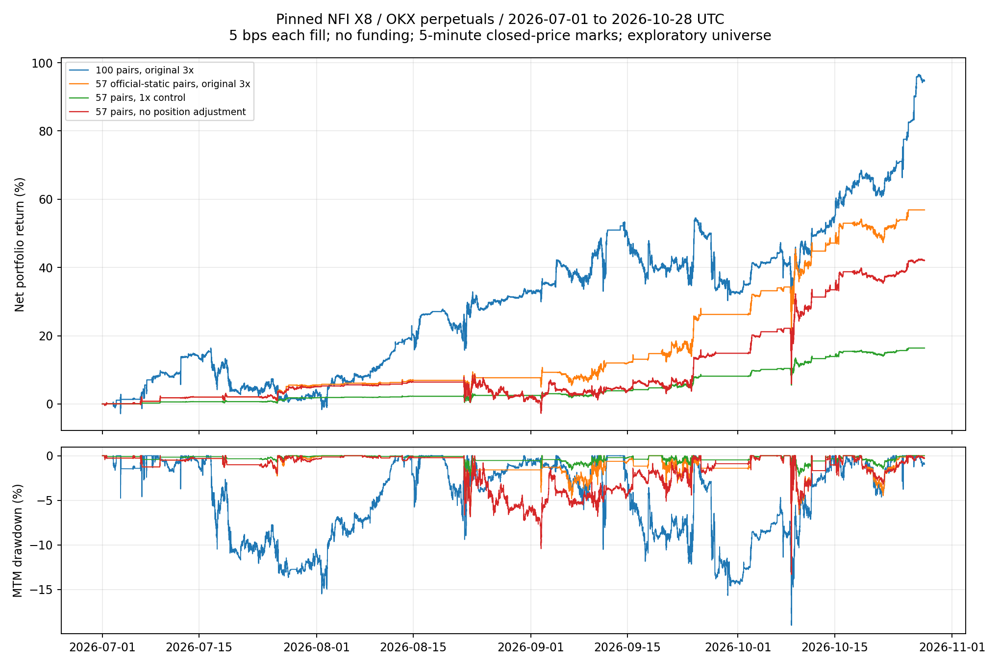

# NFI X8 首轮组合研究（2026-10-29）

## 结论与适用范围

**在本批历史、原版引擎与所列成本假设下，固定版本 X8 能盈利；尚不能证明官方实盘配置未来持续盈利。** 原版策略参数作用于现有100币池，收益 +94.68%；取其中属于官方静态名单的57币，收益 +56.87%。主要赚钱的是多头的趋势回调、强币轮动与反弹退出，而非稳定的多空套利。高胜率不等于低风险，持仓浮亏和长期磨仓必须一起看。

固定源码 `05b95e189ac5d301da2169ddec3118368f1b5c8b`、X8 `v18.0.167`、Freqtrade `2026.9`。上游源码保持不变。区间为 **2026-07-01 00:00 至 2026-10-28 00:00 UTC（不含终点）**；初始统一钱包10,000 USDT，原版3倍杠杆、6槽位、unlimited stake。每次成交单边手续费5bps，资金费按既有要求设0，未下载真实费率。没有下单、实盘运行、发布或推送。

## 官方配置到底复刻了什么

官方README推荐6–12个持仓、40–80币、5m周期、unlimited stake，必须保留自定义退出。官方示例总配置默认链接Binance；本研究遵循已授权的OKX USDT永续市场，沿用其OKX币表与示例交易参数。57币是现有100币与固定版本官方静态名单的交集，数量落在建议范围内；不是按回测收益筛选。

**不是完整官方动态交易池复现。** 官方OKX配置先按成交量取110币，再做60天年龄、3天振幅0.03–0.95及FullTradesFilter。现有数据只含今天选出的100币，缺少所有历史候选与退市币，不能准确重建历史成交量排名。补做的过滤对照仅在原57币上，以已闭合日线重建3天振幅、使用上市日期约束60天年龄、每天更新；不声称复刻所有动态池刷新/排位语义，也不改变持仓期间的原版管理。原40币数据与配置保留。

## 实际回放结果

下列回撤为逐订单现金流＋未平仓头寸重估后的5m采样权益回撤，不是仅统计已平仓交易的回撤。

| 方案 | 净收益 | 浮动权益最大回撤 | 完整持仓数 | 胜率 | 期末强平数 |
|---|---:|---:|---:|---:|---:|
| 100币原版 | +94.68% | 19.02% | 130 | 97.69% | 1 |
| 官方静态交集57币 | +56.87% | 13.32% | 61 | 100.00% | 0 |
| 57币＋历史年龄/振幅门槛 | +56.81% | 13.32% | 60 | 100.00% | 0 |
| 57币降为1倍 | +16.39% | 4.44% | 61 | 100.00% | 0 |
| 57币关闭仓位调整 | +42.03% | 13.32% | 61 | 95.08% | 1 |
| 57币12持仓槽位 | +33.73% | 10.26% | 68 | 100.00% | 0 |
| 57币单边费率10bps | +54.66% | 13.46% | 61 | 100.00% | 0 |



57币基线的已平仓回撤为0%，但浮动权益回撤为13.32%；按同步整点标记价格重估为12.49%。100币对应19.02%与18.48%。只看引擎常见的已平仓报表会显著低估持仓风险。这里的重估只覆盖采样时点，不是逐tick或同根内的最坏回撤。

57币最长持仓154.08小时，6次完整持仓发生过加仓，最多3次入场；100币最长持仓1679.67小时（69.99天），23次完整持仓加仓，单次最多100次入场成交。100币期末AERO空头被强制平仓，整段持仓净亏1874.99 USDT，已计入收益，未把未平仓亏损排除。PUMP空头净亏1686.78、SOON空头净亏1683.97；不能只展示97.69%的胜率。

## 赚的是什么钱

57币基线按完整持仓净收益归因；同笔多标签归为独立混合组，避免重复计算：

| 来源 | 持仓数 | 净利润 USDT | 占总净利润 |
|---|---:|---:|---:|
| long_top_coins | 20 | 2736.42 | 48.11% |
| long_rebuy | 16 | 804.31 | 14.14% |
| long_normal | 3 | 701.18 | 12.33% |
| short_quick | 2 | 427.43 | 7.52% |
| short_rebuy | 14 | 373.65 | 6.57% |
| long_normal+long_top_coins | 1 | 216.22 | 3.80% |
| long_rapid | 2 | 185.19 | 3.26% |
| long_scalp | 2 | 128.75 | 2.26% |
| long_pump+long_top_coins | 1 | 114.24 | 2.01% |

57币多头贡献4886.30 USDT（85.91%），空头801.09（14.09%）。纯top-coins多头贡献2736.42（48.11%），再加混合top-coins标签约占53.92%。源码标签64明确要求4h EMA12高于EMA200，是趋势内回调；141组限定主流币并结合多周期状态寻找位置。其经济来源是方向暴露、强弱轮动、回调/超卖后的恢复，不能归类成无方向的手续费套利。

55次单次入场持仓贡献5424.12，6次有加仓的持仓贡献263.27；这是已发生交易的描述，不能据此断言关闭加仓会多赚，因为关掉管理后退出、资金路径会改变。真实关闭仓位调整对照只赚4202.62，比原版少1484.77，并出现期末亏损持仓。因此不能简单删掉磨仓，也不能把局部grind盈利当成整笔盈利。

100币多头贡献12665.75，空头亏3197.75；扩池带来的收益伴随新币空头尾部风险。不能直接将这3197.75加回，宣称禁空策略的收益；禁空会改变组合占用与后续成交。57币收益前五币ARB、WLD、ICP、OP、FIL占净利润45.13%；100币前五占54.82%，需要继续关注集中度。

## 时间、成本与资金占用

| 月份（UTC月末重估） | 57币月收益率 | 100币月收益率 |
|---|---:|---:|
| 2026-07 | +5.59% | +3.75% |
| 2026-08 | +1.99% | +28.35% |
| 2026-09 | +17.23% | -0.45% |
| 2026-10 | +24.26% | +46.85% |

月份收益率按当月初权益计，连续复利；10月只到27日。7–8月与9–10月仅作时间稳定性对照，没有据此调参后宣称独立样本外。 BTC同期不加杠杆价格涨幅 +38.01%，ETH +49.51%（未扣成本，仅作背景，不与3倍组合风险等同）。

57币累计手续费242.31 USDT、双边名义成交额484620.83；100币手续费684.83、成交额1369664.39。费率翻倍的真实引擎重跑为+54.66%，不是简单在旧利润上扣费。另作固定成交路径的每笔不利滑点扣减（含加减仓），不模拟成交队列、价差或滑点引发的交易路径变化：

| 每次成交不利滑点 | 57币期末净收益 | 100币期末净收益 |
|---|---:|---:|
| 2 bps | +55.90% | +91.94% |
| 5 bps | +54.45% | +87.83% |
| 10 bps | +52.03% | +80.98% |

57币平均占用保证金成本基础532.08、峰值13293.02 USDT，暴露时间38.16%；100币平均1725.64、峰值11827.63，暴露时间94.76%。峰值高于初始资金可来自此前盈利，不表示额外外部充值；这些是已持仓成本基础，不是所有潜在补仓的准备金。杠杆会放大收益和回撤，缺失资金费可能影响持有70天的头寸。5m OHLCV撮合不能证明限价单实际会成交，也无法用现有数据验证1m或逐tick执行。

## 已验证的改进与尚未验证的想法

1. **优先降低风险暴露。** 1倍对照+16.39%、回撤4.44%，同为61笔；收益下降但回撤约为3倍的三分之一。这是可供前向模拟的保守配置，不是更高收益的“最优参数”。杠杆改变也可能改变利润阈值、最小下单与资金路径，不能保证未来严格线性缩放。
2. **保留原版仓位管理作为基线。** 删掉调整在本批数据中减益；12槽位也不是更优，收益只有+33.73%、回撤10.26%。两者失败结果均保留。
3. **不要按本次收益剔除空头/币种/标签。** 100币空头长时间套牢是明确问题，后续可预先冻结“单币累计保证金上限、最多加仓次数、时间止损与方向风险预算”分别实验；尚未实证这些规则能提高收益，强行提前止损也可能砍掉最终恢复的盈利仓。
4. **先改善研究设计，再做信号优化。** 构建历史时点池并包含退市币；以后用新到来的数据做冻结前向模拟。当前57币与100币都是事后静态选池，固定版本策略及黑名单的发布日期也晚于部分回放历史；上游迭代可能使用过历史，不能把本轮称为该版本的独立样本外。不能把二者收益差全部归功于选币能力。
5. **不先hyperopt。** top-coins提供主要收益，但仅20次纯标签持仓，不足以按单个标签优化。可按持仓时长、最大不利波动、累计保证金预算做机制对照，保留原始源码，不同时扫几十个阈值。

## 可信度检查与复现

- 43项原有标准库测试通过；100币归档、源码哈希及1594050根高周期交叉检查通过。
- 订单现金流包含所有入场、加仓、部分退出、最终退出及逐次手续费；逐笔利润与引擎、期末权益与统一钱包都核对，误差小于0.01 USDT。额外2项会计/过滤因果性测试通过。
- 57币在独立空userdir重跑，61笔交易逐字段完全一致。
- 原生lookahead-analysis抽3笔时报告3次退出偏差、无指标/入场偏差。调查发现：完整回放留下PYTH在10月13日的利润目标缓存，随后被7月截断回放读取。保留 `lookahead.csv`、`lookahead_detail.json`、`lookahead_trace.json`。`nfi_causality.py --isolate-cache`仅为每次检查更换空userdir，不改信号/退出或价格；复查3笔为0指标、0入场、0退出差异，见 `lookahead_isolated.csv`。这是有限抽查，不是对所有信号无偏差的证明。
- 初次运行修正了禁用通知模块的schema兼容、CCXT异步代理与系统CA；TLS校验未关闭。自定义过滤对照第一次因pandas时间单位不一致失败，统一时间精度并通过因果性测试后重跑成功。没有改上游策略来让结果通过。

从仓库根目录运行（所有命令都是离线历史研究，只有公开合约规格/杠杆档位初始化可能联网）：

```sh
.venv/bin/python -m pip install -r research/nfi/study/requirements.txt
.venv/bin/python -m unittest discover -s tests -q
.venv/bin/python nfi_verify.py
.venv/bin/python nfi_study.py baseline100 official official_filters official_1x official_no_adjust official_12slots official_cost10
.venv/bin/python nfi_analyze.py
.venv/bin/python nfi_plot.py
.venv/bin/python -m unittest discover -s research/nfi/study -p test_audit.py -v
```

每次运行使用独立空userdir，防止状态污染。真实引擎压缩结果与日志在各方案目录，汇总与SHA256在 `comparison.json`；逐方案 `analysis.json` 保存方向、信号、币种、退出、月份和滑点明细，`equity.csv` 保留采样权益。固定实验范围见 `research/nfi/study/plan.json`。当前合约规格与杠杆档位来自当前公开接口，而非每笔交易时的历史规格，亦属回放限制。完整原始撮合结果、图表和大CSV为生成文件，不应作为小型源码文件提交。
