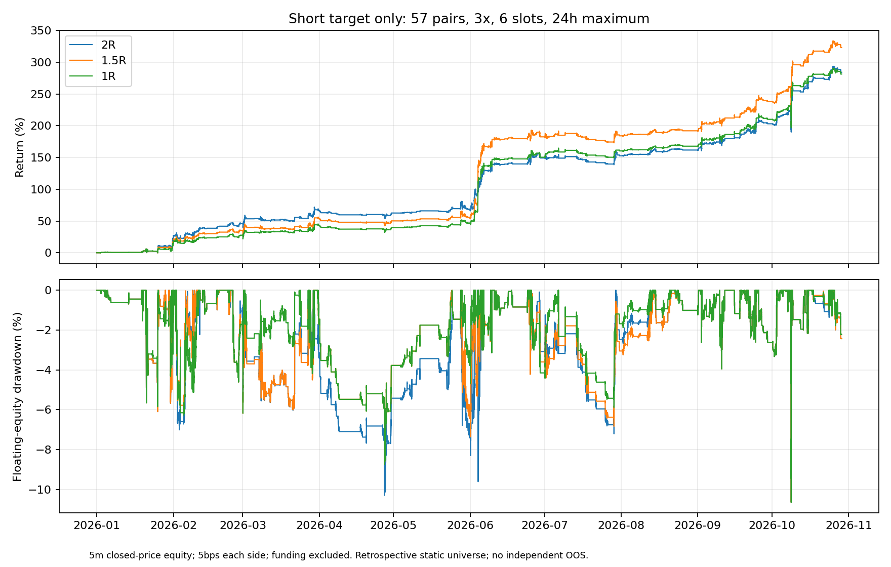

# 空头止盈目标独立复核

回放窗口（北京时间）：2026-01-01 08:00:00+08:00 至 2026-10-29 11:10:00+08:00。

57固定币、同一10000USDT钱包、3倍、最多6仓、禁止补仓、首次入场24小时。2026年初至冻结截止，资金费排除。单边5/8/12bps是真实引擎重新成交和复利回放。全部历史已查看，没有独立样本外或实盘结论。

|方案|收益%|含浮亏回撤%|平仓回撤%|PF|收益/含浮亏回撤|收益/平仓回撤|空头止盈|空头止损|
|---|---:|---:|---:|---:|---:|---:|---:|---:|
|canonical|284.18|10.65|6.22|2.71|26.68|45.67|73|81|
|canonical_r15|323.09|10.65|5.33|2.89|30.33|60.61|96|81|
|canonical_r10|281.36|10.65|4.16|2.80|26.41|67.70|133|80|
|canonical_fee8|258.26|10.73|6.79|2.59|24.07|38.05|73|81|
|canonical_r15_fee8|293.32|10.73|5.97|2.76|27.34|49.12|96|81|
|canonical_fee12|226.76|10.83|7.26|2.45|20.94|31.25|73|81|
|canonical_r15_fee12|257.34|10.83|6.57|2.60|23.76|39.14|96|81|
|cp|284.18|10.65|6.22|2.71|26.68|45.67|73|81|
|r15|323.09|10.65|5.33|2.89|30.33|60.61|96|81|

canonical为仓库原compression；canonical_r15/r10只改reward_multiple。cp/r15为用户描述的C后置过滤重建组，不混用基线。

原版与旧归档是否逐笔一致：True。若不一致，须报告环境/市场规格差异，不声称精确复现旧结果。

## 判断

主实验2R→1.5R：收益284.18%→323.09%，平仓回撤6.22%→5.33%，含浮亏回撤10.65291%→10.65262%。必须分别解释兑现效率与最大持仓风险，不能将平仓回撤改善称为全部风险下降。

short实际路径净利润：10977.89→9448.35USDT，变化-1529.54USDT。
long实际路径净利润：17439.80→22860.72USDT，变化5420.92USDT。
多头规则未修改但现金流、空闲槽位和仓位随钱包发生变化；多头利润差混合机会挤占和复利，不是单独的alpha证明。空头目标退出增加不代表空头本身净利必然增加。

收益优势集中度：按北京时间自然月，6月实际利润差4601.22USDT，而全区间利润差3891.38USDT，其余月份净差合计-709.85USDT。这是事后路径诊断，不是按月份启停规则；不同费率仍沿用同一历史，不能替代不同市场的前向验证。

## 平均回撤与资金占用

|方案|Ulcer%|日ES95%|最长已观察水下时长h|平均保证金/权益%|
|---|---:|---:|---:|---:|
|canonical|3.42|-2.35|1336.00|5.74|
|canonical_r15|2.91|-2.22|1299.17|5.32|
|canonical_r10|2.49|-2.10|1299.33|4.62|
|canonical_fee12|3.66|-2.40|1421.08|5.67|
|canonical_r15_fee12|3.26|-2.28|1654.08|5.27|

Ulcer与日尾部损失在此历史有所改善；但12bps下最长已观察水下时长增加，不能声称每项稳定性指标都更好。水下时长受窗口截断，不等于未来回本期限。

canonical最大含浮亏回撤谷底在北京时间2026-10-09 01:50:00+08:00，当时持有6仓，其中空头0仓。具体币种见comparison.json；不是整段回撤的收益归因。
canonical_r15最大含浮亏回撤谷底在北京时间2026-10-09 01:50:00+08:00，当时持有6仓，其中空头0仓。具体币种见comparison.json；不是整段回撤的收益归因。
canonical_r10最大含浮亏回撤谷底在北京时间2026-10-09 01:50:00+08:00，当时持有6仓，其中空头0仓。具体币种见comparison.json；不是整段回撤的收益归因。

## 逐笔机制检查

- canonical__canonical_r15：共同入场378；仅原组3；仅新组25；共同空头亏转盈4；盈转亏0；相同入场空头导出止损不同0；原亏损空单曾有1.5R回调报价4。
- canonical__canonical_r10：共同入场377；仅原组4；仅新组38；共同空头亏转盈16；盈转亏0；相同入场空头导出止损不同0；原亏损空单曾有1.5R回调报价4。
- cp__r15：共同入场378；仅原组3；仅新组25；共同空头亏转盈4；盈转亏0；相同入场空头导出止损不同0；原亏损空单曾有1.5R回调报价4。
- canonical_fee8__canonical_r15_fee8：共同入场378；仅原组3；仅新组25；共同空头亏转盈4；盈转亏0；相同入场空头导出止损不同0；原亏损空单曾有1.5R回调报价4。
- canonical_fee12__canonical_r15_fee12：共同入场378；仅原组3；仅新组25；共同空头亏转盈4；盈转亏0；相同入场空头导出止损不同0；原亏损空单曾有1.5R回调报价4。
- canonical__cp：共同入场381；仅原组0；仅新组0；共同空头亏转盈0；盈转亏0；相同入场空头导出止损不同0；原亏损空单曾有1.5R回调报价4。

5m权益回撤来自所有订单现金流和剩余持仓逐格估值，并与引擎最终钱包对账。小时标记价回撤、Ulcer、日ES95、月份及方向归因见comparison.json；平仓余额回撤不代表持仓风险，5m权益回撤也不代表盘中最坏风险。

止盈按真实引擎5m开盘回调价触发，未使用最低价补成交；止损使用原引擎。R是价格距离，净R包含费用后会改变。共同入场止损和新增/消失交易分别披露，不能凭止损次数一样判定路径一样。

执行失败与元数据限流、并行内存不足尝试保留在implementation_failure。最终回放串行，限定拉取57币真实杠杆规格且恢复完整市场注册表，未替换市场或伪造规格。未运行其他七个S/C/P组合挑选新基线。

