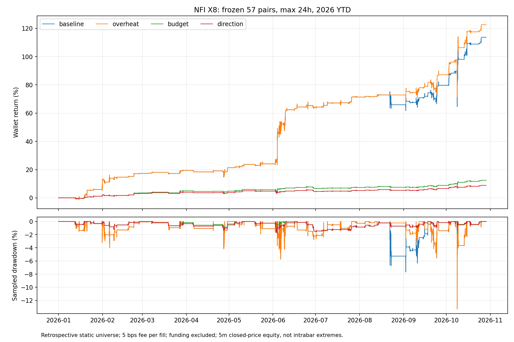

# NFI X8：2026年初至今的四组受控实验

窗口：2026-01-01 00:00 至 2026-10-29 03:10 UTC（北京时间10月29日11:10）。57个固定币种、初始10,000 USDT、同一钱包、最多6仓、原版3倍杠杆。单次持仓从首次成交计时不超过24小时。

单边手续费5bps已计入；资金费未计入。滑点表是成交路径不变的附加扣费压力，不是订单簿重放。当前57币倒推历史存在选择及存活者偏差，所有实验均是回顾研究，非独立样本外。

|版本|交易|收益|5m权益回撤|胜率|平均盈亏比|利润因子|
|---|---:|---:|---:|---:|---:|---:|
|baseline|152|113.67%|13.32%|80.26%|1.23|4.99|
|overheat|150|122.56%|13.32%|81.33%|1.51|6.56|
|budget|152|12.43%|1.83%|78.95%|0.63|2.35|
|direction|144|8.87%|1.73%|77.08%|0.57|1.92|

baseline只加24小时强平；overheat在此基础上拒绝闭合4h RSI≥80的多单和≤20的空单。budget独立使用基线信号，以闭合4h ATR14的2倍、至少价格1%的距离冻结止损，按已结算权益0.5%计划风险缩仓，加仓共享预算。direction在新增仓前要求同向冻结预算合计不超过当时可交易已结算权益的1.5%。预算并非跳空或执行损失保证。

风险预算与原始仓位上限取较小者；不是每笔必须用满0.5%。预算基数为Freqtrade可交易已结算权益（含已实现部分退出收益，再乘99%可交易比例），不含浮亏；单笔预算约占总已结算权益0.495%。同向上限使用全部同向币种这一保守代理，没有事后拟合相关系数。部分减仓不释放冻结预算，平仓才释放；权益随后下降时不会强制减仓，因此该上限是新增仓准入门槛，并非持续强制再平衡。

## 月度权益收益

|月份|baseline|overheat|budget|direction|
|---|---:|---:|---:|---:|
|2026-01|13.12%|13.12%|2.20%|2.20%|
|2026-02|3.71%|3.71%|1.28%|0.94%|
|2026-03|1.79%|1.79%|1.41%|0.82%|
|2026-04|1.64%|1.64%|-0.19%|-0.19%|
|2026-05|2.24%|2.24%|0.93%|0.93%|
|2026-06|32.32%|32.32%|0.89%|-0.24%|
|2026-07|4.37%|4.37%|0.63%|0.63%|
|2026-08|-3.16%|0.87%|0.15%|0.15%|
|2026-09|8.28%|8.28%|1.25%|1.25%|
|2026-10|18.93%|18.93%|3.28%|2.07%|

## 利润来源与风险边界

- baseline：多空归因 {"long": {"campaigns": 104, "profit_usdt": 10509.13649889, "win_rate_pct": 88.46153846153847, "max_hours": 24.0}, "short": {"campaigns": 48, "profit_usdt": 858.3146958699999, "win_rate_pct": 62.5, "max_hours": 24.0}}；限时退出41笔，其中亏损30笔。
- overheat：多空归因 {"long": {"campaigns": 102, "profit_usdt": 11385.45924232, "win_rate_pct": 90.19607843137256, "max_hours": 24.0}, "short": {"campaigns": 48, "profit_usdt": 870.2521813, "win_rate_pct": 62.5, "max_hours": 24.0}}；限时退出39笔，其中亏损28笔。
- budget：多空归因 {"long": {"campaigns": 104, "profit_usdt": 961.46469111, "win_rate_pct": 86.53846153846153, "max_hours": 24.0}, "short": {"campaigns": 48, "profit_usdt": 281.04012137, "win_rate_pct": 62.5, "max_hours": 24.0}}；限时退出30笔，其中亏损20笔。
- direction：多空归因 {"long": {"campaigns": 98, "profit_usdt": 701.93971695, "win_rate_pct": 84.6938775510204, "max_hours": 24.0}, "short": {"campaigns": 46, "profit_usdt": 184.85589115, "win_rate_pct": 60.869565217391305, "max_hours": 24.0}}；限时退出30笔，其中亏损20笔。

## 结论与取舍

1. RSI过滤只删除8月22日OP/XRP两笔；1—6月交易与收益完全不变。虽然全段收益更高，回撤未下降，仍是从已知亏损事件提出的待验证假设，不能当成跨行情确认。
2. budget保留全部152个对应入场，减少仓位并限制补仓后，回撤显著下降，收益也明显缩水。FIL（6月2日）和UNI（2月5日）两笔原本盈利被止损成亏损。平均盈利/平均亏损约0.63，低于基线约1.23，说明止损没有免费改善盈利能力。
3. direction相对budget只降低约0.10个百分点回撤，却少赚约3.56个百分点；当前不把它作为默认升级。保留它作同向冲击压力对照，不能据一次历史样本推断组合上限永远无用。
4. 下一阶段主模拟候选为budget，基线24h和direction保留独立钱包对照；暂不叠加RSI过滤。启动规范见 [前向计划](../../../research/nfi/ytd_research/FORWARD.md)，配置处于停止状态，尚未运行前向样本。
5. budget同时改变止损、仓位和补仓，不能把回撤改善全部归功于ATR止损。若继续历史实验，应先增加同风险规模的纯缩仓对照，区分缩仓贡献与退出贡献，而非继续扫描RSI或ATR参数。

基线约92%的净利润来自多头，long_top_coins与long_normal为主要来源；46笔short_rebuy只贡献约202 USDT。这更接近多头反弹/波动恢复与持仓管理收益，不能视为天然对冲组合。入场处于BTC低于且下行4h EMA200时仍有盈利，只能说明部分弱势背景中的交易可盈利，不能证明持续无反弹暴跌时安全。

本轮完成的budget/direction分别审计155/148个仍有剩余持仓的成交事件，均未发现计划止损风险或最终亏损超过冻结预算（容差0.02 USDT）；完全平仓事件不再计算剩余止损风险。真实跳空、限价无法成交及费用变化仍可突破预算。所有版本均未发现24h超期或到期后加仓。

完整亏损路径见 [trade_diagnosis.json](trade_diagnosis.json)。某个时点已浮亏并不代表后续必亏；替代退出必须重新回放，不能按最终输赢事后决定谁提前平仓。

逐信号族、BTC入场状态、半年、最差交易、费用与滑点敏感性见 [comparison.json](comparison.json)。BTC状态只使用入场时最后已闭合4h及EMA200过去24小时斜率；它是描述性分组，不能证明整段单边熊市存活。不同版本交易数与资金路径会变化，不能将收益差全部解释为被删除交易的原始盈亏。

## 可复现与检查

运行 `.venv/bin/python nfi_ytd_study.py baseline overheat budget direction`，再运行 `.venv/bin/python nfi_ytd_analysis.py`。每组使用隔离缓存和真实Freqtrade引擎，原版源码不改动。已完成的目录重跑前应另存归档，分析拒绝多份ZIP。

订单现金流逐笔对账，并用最后已收盘5m价格重建持仓权益；整点真实标记价格另做敏感性核对。所报回撤是离散采样，不含盘中极值。预算成交审计见各组analysis与risk_audit_events。

## 30笔亏损的路径诊断

基线亏损共30笔，亏损合计2852.10 USDT；四笔最大亏损占50.72%。其中27笔曾出现扣手续费及预计平仓费后的正浮盈，但正浮盈可能很小，不能直接推导可锁定利润。另有3笔在5m采样中未净盈利。

仍持有到对应时点、当时净浮亏、最终却盈利的交易：6小时21笔，12小时10笔，18小时4笔。简单按‘浮亏太久’强退会误杀，必须用真实回放衡量。

|最大亏损|最终净损益USDT|6h浮动净损益|12h浮动净损益|持仓内最高净浮盈|
|---|---:|---:|---:|---:|
|ALGO/USDT:USDT long|-430.98|-314.68|-328.45|-7.87|
|OP/USDT:USDT long|-348.06|-136.64|27.71|87.12|
|XRP/USDT:USDT long|-341.67|-173.09|-125.92|150.38|
|AR/USDT:USDT long|-325.87|-118.48|-172.71|18.92|
|JUP/USDT:USDT short|-154.42|-80.10|-62.81|20.51|

ALGO这类始终偏弱的交易需要风险预算或失效退出；OP/XRP主要是强势末端入场后反转，闭合4h RSI过热只是可解释特征；空头rebuy则需警惕下跌后的反弹。这些是现有路径的诊断，不是事前必然可辨认的标签。

